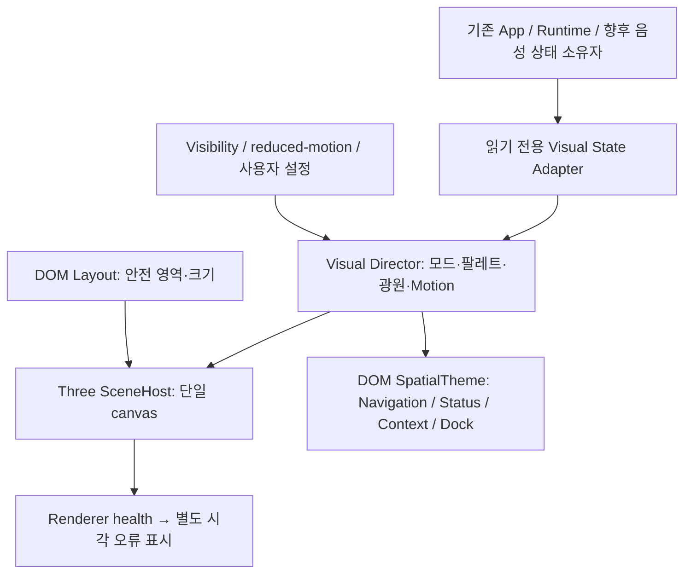

# P1.2 Cinematic 3D Core & Unified Spatial Interface 설계

Refs #30. 2026-11-12 KST. **PROPOSED / 사용자 설계 검토 대기**.

> 변경 이력: 이 문서는 PR #31로 승인·병합된 당시 설계 기록이다. 이후 사용자 요구로
> P1.2b의 금속 Orbital/레일 중심 방향은 Living Neural Intelligence Core로 변경됐다.
> 새로운 우선 요구·범위·합격 기준은 [P1.2b 설계 보완](p1-2b-living-neural-core.md)을 따른다.
> 아래 기존 궤도·금속 구조 설명은 이력으로 보존하며 현재 b 구현 지시로 해석하지 않는다.

이번 문서는 기술·시각 설계와 개발 순서만 제안한다. 코드 구현, 의존성 설치, 빌드, 앱 실행,
렌더링·성능 실험을 승인하거나 수행하지 않는다. 수치·도식은 설계 목표이며 실측 결과가 아니다.

## A. 기준과 현황

- 기준 main: `08bdc3175b0f99fcdd79c0a6458481a4ebd358bb`.
- P1.1 [#29](https://github.com/Kim-Ji-Won/AETHER/pull/29) MERGED / [#28](https://github.com/Kim-Ji-Won/AETHER/issues/28) CLOSED.
- 승인된 것은 Navigation, 네 화면, Slim Command Bar, 기본 레이아웃·정보 구조, 접근성과 기존 기능 유지다.
  최종 AETHER 비주얼, 기존 2D Core 또는 후속 3D 품질 승인이 아니다.
- 열린 작업 확인 결과 P0 E5b [#27](https://github.com/Kim-Ji-Won/AETHER/issues/27)만 있었고 P1.2 중복 Issue/PR은 없었다.
  설계 Issue [#30](https://github.com/Kim-Ji-Won/AETHER/issues/30)을 분리했다.
- `docs/30-spatial-interface-design`은 위 main에서 분기한다. 기존 UI worktree를 재사용하되
  `feat/28-ui-shell` 브랜치, P1.1 앱, 캡처, E4/E5 산출물은 보존한다. E5b worktree는 사용하지 않는다.
- 이번 변경 파일은 이 문서 하나다. 이전 [P1.1 검증 문서](p1-ui-shell.md)의 미승인 플래그는 당시 기록이다.
  최신 P1.1 Shell 승인과 병합 사실은 PR #29 및 이 문서의 범위로 해석한다.

### 확인한 코드와 보호 경계

`Shell.tsx`는 page, draft, preview, motion을 소유한다. Main에는 `.scene-viewport` 예약 영역이 있으며,
기존 `Core.tsx` / `ReactorScene.tsx`는 Command Center의 선택형 2D Preview다.
`useMotion.ts`의 현재 sceneVisible 조건은 **Command + legacyPreview** 전용이다.
새 Main Scene은 별도 visibility 입력이 필요하며 기존 조건을 그대로 재사용하면 Main이 계속 정지한다.
`motion-off` CSS만으로 WebGL 렌더 루프가 멈추지는 않으므로 renderer scheduler에도 명시적으로 전달해야 한다.

페이지 전환 후 AX 본문 누락을 수정한 DOM 순서와 persistent `FakeRun` 마운트를 유지한다.
Rust ledger·승인, Swift sheet, Node child, Runtime session/epoch, 기존 IPC·CSP·capability·pin은 변경하지 않는다.
[E4e](e4e-lifecycle-safety.md)의 hide/minimize는 Runtime 생존, reload는 A failed/B snapshot 유지,
마지막 창 close/Quit는 기존 종료 정책을 유지한다. **시각 정지와 Runtime 취소는 다른 동작**이다.
[E5a](e5a-measurement-foundation.md)의 WebKit 귀속 UNAVAILABLE, 실제 renderer crash NOT_RUN을
3D context-loss 시험이나 과거 단일 smoke로 해결했다고 표시하지 않는다.

### Visual Reference 해석

| 사용자 참조 | 채택할 원칙 | 그대로 구현하지 않을 부분 |
|---|---|---|
| 3번 | Navigation·Context·Command Dock의 제품 구조, 공통 소재와 정보 계층 | 큰 반복 브랜딩, 가상 Intelligence 수치, 상시 카드 밀집. P1.1의 접힌 Context·상태 유지 |
| 2번 | 내부 필라멘트가 공간을 채우는 에너지, 중심과 외곽의 명암·유기적 흐름 | 평면 구체 표면의 발광 무늬나 고정 영상으로 대체 |
| 1번 | Chamber 천장·바닥·후경의 규모, 금속 궤도, 하나의 중심광 | 전체 이미지를 배경으로 넣어 실제 장면/조작처럼 표현 |

세 이미지는 사용자 제공 콘셉트이며 구현 증거·픽셀 설계도가 아니다. 이미지 파일은 앱이나 저장소에 복사하지 않는다.

## B. Renderer 선택과 의존성

**권장 후보: Three.js WebGLRenderer + 작은 React 수명주기 경계. R3F는 비교 후보로 보류.**
선택 이유는 장면이 하나이고 직접 조작하는 3D 객체가 적으며, 렌더 정지·복구·GPU 자원 해제를
명시적으로 검토하는 것이 중요하기 때문이다. R3F가 본질적으로 느리다는 주장은 하지 않는다.
직접 관리 방식은 코드 책임이 늘어나므로 P1.2a에서 StrictMode 재마운트와 cleanup 검증이 필수다.

2026-11-12 공식 npm registry 메타데이터를 **설치 없이** 조회했다.

| 패키지 | 정확한 후보 버전 | 라이선스 | 제안 |
|---|---|---|---|
| `three` | `0.187.0` | MIT | runtime 후보. 같은 패키지의 addons만 필요 단위로 사용 |
| `@types/three` | `0.187.0` | MIT | dev 후보. runtime에 import하지 않음 |
| `@react-three/fiber` | `9.8.2` | MIT | 비교 후보, 기본 계획에서는 설치하지 않음 |

`three` 메타데이터에는 runtime dependency가 없다. `@types/three`에는 fflate, WebXR/stats 타입,
meshoptimizer, tween, rapier 관련 전이 의존성이 있으므로 dev 패키지라고 감사를 생략하지 않는다.
R3F 9.8.2의 peer 범위는 React/React DOM `>=19 <19.4`, Three `>=0.156`이다.
저장소의 React/React DOM `19.3.1`은 메타데이터 범위에 들어가지만 **빌드·실행 호환성 PASS는 아니다**.
R3F는 scheduler, zustand 등 전이 의존성도 추가한다. 웹 앱에 Expo/React Native를 설치할 이유는 없다.

R3F의 선언형 Scene, 컴포넌트 재사용, frame scheduling은 장점이다. 향후 3D 상호작용이 커지거나
직접 관리 코드의 유지 비용이 확인되면 별도 변경 제안으로 재검토한다. 이번에 이중 renderer를 만들지 않는다.
WebGPU/alpha, Drei, 별도 postprocessing 패키지, physics, 외부 모델 로더는 초기 범위 밖이다.

설치 승인 전 exact pin·lockfile 전이 그래프·라이선스 고지·보안 advisory·현재 TS/Vite 호환성을 재확인한다.
이번 조회는 보안 감사나 설치 승인이 아니다. MIT 고지를 배포물에 포함하고, 모델·환경맵·텍스처 라이선스는
라이브러리와 별도로 관리한다. 초기 장면은 자체 procedural geometry/환경 조명을 우선한다.

### WKWebView와 fallback

공식 WebKit 자료는 Safari 15에서 WebGL2와 Metal 기반 구현을 설명한다. Three r187 WebGLRenderer는
WebGL2를 사용하며 WebGL1 fallback을 제공하지 않는다. macOS 버전 이름만으로 해당 앱의 성공을 보장하지 않는다.
P1.2a의 실제 arm64 WKWebView에서 context 생성, shader compile, render-target completeness,
최대 texture/renderbuffer 크기, HDR 관련 extension을 확인한다.

- WebGL2/context 생성 실패: 기존 DOM Shell과 명확한 정적 fallback. 자동 재시도 루프 없음.
- HDR target 미지원: LDR 렌더와 Bloom 비활성 경량 3D. 이는 별도 품질 모드이며 최종 품질 PASS와 구분.
- shader 실패: 오류 범위를 격리해 DOM 상태·입력 유지. 정상 AI 상태를 error로 바꾸지 않고 시각 오류를 별도 표시.
- context loss: 루프 정지·자원 무효화·정적 fallback. 복원 시 자원 재생성은 제한적으로 시도하고
  반복 실패는 사용자 재시도로 넘긴다. 실패 전 자원을 재사용하거나 무한 복원하지 않는다.
- 원격 코드·CDN·외부 폰트·모델 fetch, `eval`, CSP 완화, 신규 native 권한을 전제하지 않는다.
  shader와 필요한 자산은 번들에 포함한다. 현재 CSP 아래 패키지 테스트가 설치 이후 게이트다.

## C. Scene Architecture와 Camera



화살표는 제안 계약이다. Renderer에서 Runtime 명령·승인·마이크로 돌아가는 제어 경로를 만들지 않는다.

### 하나의 공간과 DOM 계층

1. **후경**: Shell client 영역의 단일 canvas. 먼 Chamber, 천장 aperture, 바닥을 같은 카메라 공간에 둔다.
2. **중경**: Core와 두께 있는 Orbital. 중앙 밝기·가림·음영이 깊이를 설명한다.
3. **전경**: 실제 DOM Navigation·Context·상태·Dock. 공통 실버 경계와 제한된 시안 반사 표현.
   텍스트 아래는 충분한 불투명도를 유지하고 3D Bloom이 DOM 텍스트에 적용되지 않게 한다.

Main에서 canvas는 `.shell`의 배경 계층까지 이어질 수 있지만 **Core 투영 영역은 기존 Scene 안전 영역으로 제한**한다.
Nav 아래의 Chamber 광량과 DOM rim light가 이어지게 하여 Scene만 별도 카드처럼 보이지 않게 한다.
단일 renderer/카메라의 off-axis framing으로 안전 영역 중심을 맞춘다. Nav·패널별 canvas를 만들지 않는다.
native titlebar는 canvas 바깥이다. 기존 macOS 창 조작을 유지하고 색·명암만 조화시킨다.

canvas는 기본 `aria-hidden`, 비상호작용, pointer-events 없음으로 설계한다. 상태·오류·Preview 표시는 DOM에 남는다.
다른 세 화면에는 동일 소재 토큰과 정적인 공간 배경을 사용하고 3D loop는 중지·해제한다.
메인 복귀 시 재초기화가 부담되면 먼저 측정한 뒤 bounded cache를 검토한다. 무기한 GPU cache는 기본값이 아니다.

### Camera와 세 창 크기

기본 perspective vertical FOV 35°를 출발점으로 하되 최종 값은 실제 앱 시각 게이트에서 정한다.
자동 카메라 회전·마우스 parallax는 기본 OFF. 검증용 고정 정면/±15° 시점만 Diagnostics에서 허용한다.
전체 Orbital bounding volume이 안전 영역에 들어오도록 aspect, FOV, 거리, principal point를 함께 계산한다.
창 전체 크기가 아니라 ResizeObserver로 얻은 CSS pixel 기준 실제 Scene rect와 Dock 높이를 사용한다.

| 조건 | 배치 계약 |
|---|---|
| 900×760 | 72px Nav 유지. 작은 상태/Context 버튼과 기본 60px Dock을 항상 표시. Core+주궤도는 안전 영역 짧은 변의 약 70~82%를 초기 목표로 배치 |
| 400×680 | 60px Nav와 32px Dock 버튼 유지. 장면 프레이밍을 다시 계산하고 작은 HUD/후경 구조를 생략. UI 글자·버튼을 함께 축소하지 않음 |
| 1200×800 | 빈 영역을 카드로 채우지 않고 Chamber 깊이 확장. FOV를 과장하지 않고 Core 규모와 여백 균형 유지 |
| Dock 여러 줄 | 최대 120px Dock과 안내문을 먼저 확보하고 Scene 높이를 재계산. Core/궤도/상태 잘림 금지 |
| 탐색 펼침·Context/상태 열림 | 텍스트/조작 패널 우선. 패널 rect를 exclusion 영역으로 전달. 공간이 부족한 최소 창에서는 장면을 정지·감광하고 패널이 Core를 일시 가리는 것을 허용하되 Dock은 가리지 않음 |

모든 궤도의 운동 범위를 포함한 bounding volume으로 검사한다. Camera tween 때문에 입력 Focus가 움직여서는 안 된다.
reduced-motion에서 Camera·resize 전환은 즉시 재구도한다. 창 크기 변경을 위해 계속 렌더링하지 않는다.

### Renderer lifecycle

`unmounted → initializing → ready-static / ready-animated → suspended → disposed`와 `lost/failed` 분기를 둔다.
React wrapper는 mount/unmount, resize, context event, visual snapshot만 연결한다.
renderer는 geometry/material/texture/render target/composer pass/listener/RAF 소유권을 한 곳에서 추적한다.
unmount에서 RAF 취소 → 구독·observer 제거 → 자원별 dispose → 참조 해제 순서를 지킨다.
StrictMode의 setup/cleanup/setup, 페이지 왕복 20회, reload, Quit에서 중복 loop/context가 없어야 한다.

숨김·최소화·비활성·Main 이탈: 즉시 예약 frame 취소, 시각 timer 0. 복귀 시 누적 delta를 따라잡지 않는다.
reduced-motion/사용자 Motion OFF: 고정 구도, 상태/resize 시 필요한 단발 frame만 렌더한다.
실제 GPU context-loss 주입과 WebKit renderer process crash는 별개이며, 공유 WebKit PID에는 신호를 보내지 않는다.

## D. Orbital / Plasma / Lighting / Materials

### Orbital Intelligence

- 주구조 2개와 보조 segmented arc 1개를 초기 구도로 제안한다. 닫힌 얇은 선 링을 여러 개 복제하지 않는다.
- 곡선을 따라 폭·두께를 가진 리본/레일 단면을 sweep한 mesh, bevel, 제한된 패널 이음새를 사용한다.
- 궤도면 기울기·폭·반경·단면을 다르게 하며, 앞/뒤 면의 두께와 가림이 ±15° 고정 시점에서도 확인돼야 한다.
- 기본 0.015~0.04 rad/s의 느린 독립 운동을 제안한다. 카메라 고정, 동기 회전 금지, 충돌하지 않는 운동 범위.
- silhouette에 기여하지 않는 미세 부품은 줄이고 반복 부품은 geometry/material 공유 또는 instancing 후보로 둔다.
- 금속은 roughness가 다른 실버/어두운 합금 두 계층. 중심을 향한 면에 반사가 모이고 반대 면은 어두워야 한다.

### Neural Plasma

**권장: 한 개의 bounded 3D density volume + 소수의 실제 3D filament curve.**
단순 구 표면의 noise shader, camera-facing sprite 묶음, 영상·이미지는 최종 대안이 아니다.

구조를 다음처럼 분리한다.

1. Core 로컬 3D 좌표에서 저주파 domain warp와 고정 seed의 흐름장을 정의한다.
2. 중심·외곽 density envelope 안에 필라멘트/에너지 밀도를 만들고 시간에 따라 연속적으로 이동시킨다.
3. 카메라 ray와 bounded volume의 진입/이탈 구간 안에서만 샘플링한다. 전면→후면 emission/absorption 합성,
   낮은 transmittance에서 조기 종료한다. raymarch shader는 fragment에서 실행되지만 실제 3D 좌표와 가림을 계산한다.
4. 일부 주필라멘트는 3D tube/curve로 만들어 앞뒤 교차와 내부 깊이를 읽게 한다. physics/유체 solver는 사용하지 않는다.
5. opaque Orbital/Chamber의 depth texture를 같은 공간으로 복원해 ray 종료 거리를 제한한다.
   volume 앞·안·뒤에 놓은 검증 mesh가 올바르게 가려져야 한다. 투명 object sorting만으로 해결하지 않는다.

Balanced 32 step, High 48 step, 최대 64 step을 제안한다. Core 투영 bounds로 처리 범위를 줄인다.
저해상도 volume target은 depth-aware upsample과 silhouette 검증이 전제다.
프레임별 무작위 jitter/TAA는 초기에 제외해 shimmer·reduced-motion 문제를 줄인다.
유리 외피는 선택 사항이며 refraction으로 내부 volume 합성을 복잡하게 만들면 후순위로 보류한다.
실패 시 3D tube/curve 중심의 경량 모드로 전환하되 **Neural Plasma 최종 품질 완료로 판정하지 않는다**.

### Render graph와 조명

제안 순서: opaque Chamber/Orbital color+depth → depth-aware Plasma 합성 → 제한된 강조/선택 유리 →
Bloom → tone mapping / sRGB output → 브라우저 DOM 합성.
한 texture를 동시에 읽고 쓰지 않으며 ping-pong target 소유권·resize/dispose를 명시한다.

- 중심 emission과 실제 point/key light를 같은 상태 값으로 조정한다. 발광 material만으로 주변이 조명된다고 주장하지 않는다.
- 낮은 rear fill과 rim light로 어두운 금속 윤곽을 분리한다. 초기 동적 shadow는 OFF, 필요 시 한 광원의 제한된 shadow만 별도 예산 검토.
- 환경 반사는 자체 절차형 환경/PMREM을 초기 한 번 생성하는 안을 우선한다. 매 프레임 cube reflection은 제외한다.
- 바닥은 낮은 rough reflection/명암으로 규모를 표현한다. screen-space reflection·물리적으로 정확한 다중 반사·global illumination은 초기 범위 밖이다.
- 금속 기본은 MeshStandardMaterial, 필요한 좁은 면만 MeshPhysicalMaterial 후보. 전면 유리 transmission·다중 투명 layer를 남발하지 않는다.
- 청백색 중심, 시안 에너지, 실버 구조, 저채도 바이올렛 보조광. 중심이 밝아도 필라멘트·금속 silhouette이 사라지면 실패다.
- scene 계산은 linear, color texture와 DOM 토큰은 올바른 sRGB 변환을 사용한다. tone mapping은 최종 출력에서 한 번만 적용한다.
- Bloom은 Three addon 후보이며 emissive high-luminance 부분만 기여하도록 조정한다. DOM 텍스트와 전체 Nav에 blur/Bloom을 걸지 않는다.

## E. Unified Spatial Interface 계약

제안 파일 경계: `scene/SceneHost.tsx`, `scene/renderer.ts`, `scene/visual-state.ts`, `scene/framing.ts`,
`scene/orbital.ts`, `scene/plasma/`, `scene/lighting.ts`, `scene/quality.ts`, `spatial-theme.css`.
이는 향후 구현 범위 명세이며 이번에 파일·API를 생성하지 않는다. 기존 `ShellParts`는 DOM 조작 소유권을 유지한다.

| 입력/출력 | 의미·소유권 |
|---|---|
| schemaVersion / sequence | adapter가 만드는 단조 갱신 번호. 오래된 시각 snapshot 거부. Rust session 프로토콜을 대체하지 않음 |
| source: actual / preview | 상태 출처. preview이면 Core와 상태 근처에 지속적인 Preview 표시 |
| connection | 실제 Provider·voice 연결 여부. preview 상태가 이를 덮어쓰지 못함 |
| phase | 기존 8개 상태. 실제 미연결 기본은 offline. 실제 AI가 없으면 thinking/listening/speaking은 Preview만 |
| illuminationEnabled | 기존 코어 점등은 로컬 시각 동작으로 보존. AI 연결/승인 완료 의미를 만들지 않음 |
| inputLevel / outputLevel | 향후 음성 소유자가 제공하는 0~1 envelope 또는 null. 원음·텍스트·API key는 전달하지 않음 |
| motionPolicy / quality | 시스템·사용자·visibility 정책과 명시적 품질 모드. renderer가 임의로 사용자 설정을 해제하지 않음 |
| viewport / safeRect / exclusions | CSS pixel과 DPR, Nav/패널/Dock 배치. pointer/Focus 정보 소유권은 DOM |
| lightDirection / palette / energy | Visual Director가 phase/envelope에서 도출한 한정된 공통 연출 값. renderer가 실제 상태를 새로 만들지 않음 |
| rendererHealth | ready / degraded / unavailable / lost. GPU 오류와 AI Runtime 오류를 구분하는 진단 출력 |

DOM은 같은 팔레트·광원 방향·energy를 CSS custom property로 받아 경계/표면만 조정한다.
매 프레임 React 전체 state를 갱신하거나 GPU pixel readback으로 DOM 빛을 추출하지 않는다.
phase는 이벤트 단위, envelope는 최대 20Hz의 제한된 외부 snapshot으로 받고,
3D는 자체 uniform 보간, DOM은 최대 10Hz의 좁은 style 갱신을 초기 상한으로 제안한다.
Motion OFF에서는 envelope 기반 맥동도 정지하고 의미 있는 텍스트 상태만 갱신한다.
전달 중단 시 envelope는 250ms 내 감쇠시키되, timeout만으로 연결 상태를 임의 변경하지 않는다.

| phase | Core 연출 | DOM 반응 / 진실성 |
|---|---|---|
| offline | 낮은 고정광 | 미연결·disabled 사유. Ready처럼 표현하지 않음 |
| idle | 느린 구조 운동·낮은 흐름 | 안정된 실버/시안, 상시 밝기 맥동 없음 |
| listening | 실제 input envelope에 제한 반응 | Dock의 작은 입력 강조. 마이크 미연결은 Preview |
| thinking | 내부 흐름 집중, 궤도 속도 급변 없음 | 실제 처리 상태만 표시. 가상 분석 수치 없음 |
| speaking | 실제 output envelope와 동기화 | Dock/상태 경계만 부드럽게 반응 |
| awaiting_approval | 운동·에너지 감소 | 승인 필요 텍스트 우선. 승인 소유자·native sheet 그대로 유지 |
| executing | 실제 단계 이벤트에만 반응 | Fake Runtime을 실제 AI 실행으로 매핑하지 않음 |
| error | 비섬광 정지 구도 | 텍스트·아이콘·복구 조작. 시각 오류는 rendererHealth로 별도 표시 |

hover/focus는 120~180ms의 좁은 소재 변화, phase 전환은 300~500ms를 시작값으로 제안한다.
Focus outline은 광원/Preview와 독립적으로 항상 보인다. 패널 tilt·텍스트 깊이 변형은 기본 OFF.
P1.2에서 실제 음성 capture/playback은 구현하지 않는다. P3의 상태 공급자를 나중에 adapter에 연결한다.

## F. 성능·배터리·접근성 예산과 측정

아래는 **승인 전 제안 예산**이다. 아직 측정값·PASS·모든 Apple Silicon 보장이 아니다.

| 항목 | Balanced 기본 / High 선택 | 실패·한계 처리 |
|---|---|---|
| frame | 30fps / 60fps 목표, steady-state frame interval p95 ≤33.3 / ≤16.7ms | startup/shader compile 별도 집계. 예산 미달 시 품질 축소 및 원인 기록 |
| DPR | ≤1.25 / ≤1.5, 실제 device DPR 이하 | 400px에서도 글자는 DOM 해상도 유지 |
| 장면 복잡도 | 총 render pass 포함 draw calls ≤60, scene triangles ≤150k | renderer.info는 GPU byte 사용량으로 해석하지 않음 |
| shader/효과 | Plasma 32 / 48 step; 최대64, Bloom 1 chain | step·해상도·Bloom 순으로 단계 축소, 무제한 동적 sample 증가 금지 |
| GPU frame time | 유효 계측 시 p95 ≤12 / ≤10ms 제안 | timer query 지원/disjoint 확인. CPU submit 시간을 GPU time이라 부르지 않음 |
| memory | 같은 Shell 정적 fallback 대비 귀속 가능한 총 RSS 증가 ≤150MiB | WebKit 귀속 불가면 해당 항목 UNAVAILABLE, Host만으로 PASS 금지 |
| GPU 자원 | 소유한 render targets/texture/buffer 계산치 ≤64MiB 초기 목표 | driver 실제 메모리와 별도. 20회 왕복 후 live 자원 수 기준선 복귀 |
| 입력 | 입력→다음 paint p95 ≤100ms | 한글 IME·Tab·Context 전환도 검사, 3D 속도보다 Dock 반응 우선 |
| 숨김/최소화 | 지속 RAF/render/시각 timer 0 | OS의 모든 GPU 활동이 0이라고 주장하지 않음 |
| reduced-motion | 지속 회전·맥동·카메라 이동 0, 상태/resize 단발 render | reduced-motion 해제 시에만 사용자 Motion 설정과 함께 재판정 |
| energy | 정적 대비 package power 중앙값 증가 ≤2W / ≤3W를 초기 검토선으로 제안 | 장치·전체 시스템 값. 앱 귀속/도구 미확보 시 UNAVAILABLE, 배터리 수명으로 환산하지 않음 |

자동 품질 조정은 명시적 단계와 hysteresis를 두며 요동하지 않게 한다. 낮춤은 3초 이상 지속 저하 뒤,
재상향은 30초 안정 뒤를 초기 제안으로 한다. 같은 프레임에서 target을 반복 재할당하지 않는다.
정량 비교에서는 자동 조정을 끄고 각 품질을 고정해 측정한다. user Motion OFF는 품질 적응과 무관하게 우선한다.

### 승인 후에만 실행할 측정 프로토콜

- source SHA·bundle hash·macOS/build·칩·display/주사율·창 크기·DPR·전원·밝기·온도 상태·품질을 기록한다.
- 동일 앱의 정적 / Balanced / High를 동일 장치·전원·밝기·Preview seed로 비교한다.
  frame은 warm-up 30초 후 120초×3회, 순서를 교차하고 실패·중단·제외 사유를 보존한다.
- frame interval, JS update/submit, 유효 GPU timer, DOM input latency, shader startup을 별도 지표로 보관한다.
  p95는 nearest-rank와 유효 n을 함께 보고하고 서로 다른 크기·품질·상태를 섞지 않는다.
- Instruments/Metal System Trace와 Web Inspector는 가능한 후보이지 WKWebView 귀속 성공을 보장하지 않는다.
  extension/GPU timer/renderer PID 귀속을 못 얻으면 UNAVAILABLE. 권한을 우회하거나 공유 helper를 종료하지 않는다.
- energy는 최소 15분×3회 paired baseline 비교를 후속 전용 시간에 제안한다. AC power와 battery 방전 시험을 구분한다.
  배터리 % 하나, 짧은 smoke, 기기 전체 순간 전력으로 앱 배터리 효율을 단정하지 않는다.
- 900×760·400×680·1200×800, static/8-state Preview, Context/Status, Dock 1줄/최대 높이,
  Nav 펼침, 숨김/최소화, GPU failure, renderer unmount, Runtime 중 페이지 전환을 각각 관찰한다.
- 계측 오버헤드 ON/OFF와 screenshot/녹화 부하를 분리한다. 성능 측정 중 GUI 자동화·녹화는 하지 않고 시각 증거를 별도로 수집한다.
- P0 E5 Harness나 결과 파일에 P1 그래픽 표본을 넣지 않는다. 후속 P1 전용 ignored 결과 경로와 비식별 요약을 사용한다.

접근성 합격 기준은 정상 텍스트 4.5:1, 큰 텍스트/필수 비문자 경계 3:1을 목표로 하며 가장 밝은 상태에서도 검사한다.
Canvas 정보는 DOM 상태로 동등하게 제공한다. Tab 순서·Esc·포커스 복귀·숨겨진 h1·AX 본문·버튼 이름을 보존한다.
음성 낭독은 향후 실제 VoiceOver 별도 검사로 남기며 AX tree만으로 낭독 PASS를 만들지 않는다.

## G. P1.2a~e 개발 순서

분할은 적절하지만 **시각 계약·색 관리·기본 조명은 a/b에서 시작**해야 한다.
d에서 처음 조명을 넣거나 e에서 처음 DOM 안전 영역을 연결하면 앞 단계의 geometry/shader를 다시 설계하게 된다.
순서는 a → b → c → d → e이며 각 단계가 독립 사용자 검토 단위다. 이전 단계 합격은 최종 비주얼 합격이 아니다.

| 단계 | 구현 범위 / 제외 | 시각 합격 기준 | 실제 앱·성능·접근성 검증 | 실패 시 복구 / 사용자 게이트 |
|---|---|---|---|---|
| **a Scene Foundation** | 승인된 의존성 pin, 단일 SceneHost, framing, visual contract v1, color pipeline, static fallback, lifecycle. 최종 Core·Bloom·음성 제외 | 검증용 mesh로 원근/깊이와 세 크기 안전 영역 확인. 최종 Core 시안으로 제시하지 않음 | arm64 패키지, context 생성/실패, 20회 왕복, StrictMode, hide/minimize, reduced-motion, Dock 최대높이, AX/Focus. 자원 해제·loop0·기준 frame/RSS 수집 | 기존 Scene reserved/fallback으로 되돌림. 사용자는 공간 구도·fallback·조작 보존을 승인 |
| **b Orbital & Materials** | 두께 있는 2주궤도+보조구조, 기본 금속·중립 중심광·정적 환경. Plasma·최종 Bloom 제외 | 정면/±15°에서 두께·앞뒤 가림·재질 차이·규모 확인, 원자 모형 인상 회피 | 세 크기 캡처/짧은 clip, 운동 전체 bounding volume·삼각형/draw 예산·색 대비·Motion 정지. 공통 E3b~E5a 회귀 | 이전 a 장면 유지, geometry/자원만 비활성 또는 revert. 사용자는 구조와 소재 중간 품질 승인 |
| **c Neural Plasma** | bounded volume+3D filament, depth 합성, seed/time, 8-state Preview. 실제 음성·최종 환경 연출 제외 | 내부층과 흐름이 시점 변화에도 깊이로 보임. 궤도 앞/안/뒤 가림, 표면 무늬·발광 원반으로 보이면 실패 | 고정 camera 비교·depth 검증 mesh·clip, step/resolution별 GPU/프레임, compile fail/fallback, 정적 Motion. Runtime 상태 혼동 없음 | Plasma OFF → b Orbital로 복구. 경량 모드와 최종 품질 구분, 사용자는 Plasma 품질 별도 승인 |
| **d Cinematic Lighting** | Chamber 전후경, 중심광/환경 반사, 제한 Bloom·선택 유리, 품질 단계. 실시간 GI·다중 반사 제외 | 밝은 중심과 어두운 구조가 같은 광원에 속함. Bloom을 꺼도 형태·깊이 유지, 하얀 포화로 세부 소실 금지 | 세 크기·8상태·가장 밝은 frame 대비, 금속/유리 합성, LDR/HDR degrade, 고정 품질 성능·전력 전용 측정 | effect별 OFF 또는 c 기본 조명으로 복귀. 사용자는 장면 전체 조명·재질·편안함 승인 |
| **e Unified Spatial UI** | DOM 공통 소재·광원·상태 반응, 얇은 Nav/Dock 통합, Context/Status 전경, 네 화면 일관성. 실제 AI/음성/승인 기능 추가 제외 | Core와 UI가 하나의 공간으로 보이고 카드 대시보드 경계가 두드러지지 않음. 가독성과 Core 중심성 동시 충족 | 네 화면×세 크기, 상태·panel·Dock matrix, 키보드/VoiceOver/AX, motion·loss·Quit·E3b~E5a 회귀, 통합 GPU/RSS/energy | DOM theme/반응을 기본 P1.1 토큰으로 되돌려 조작 유지. 사용자 통합 시각 승인 후 별도 HEAD 병합 승인 |

각 단계 공통: TypeScript production build, Rust/Node 관련 회귀, arm64 packaging, governance/diff/security,
실제 앱 GUI 및 source SHA/bundle hash, CI를 구분한다. 변경되지 않은 테스트 입력 재사용은 근거와 SHA를 명시한다.
기능 테스트·CI·AI 평가로 사용자 시각 승인을 대신하지 않는다. P6는 e의 통합 체계를 바탕으로 장치별 최종 미세 조정·장기 성능을 다룬다.

## H. Issue / Draft PR / 승인 방식

1. 이번 #30은 설계 전용 Draft PR을 main 대상으로 제출하고 검토 후 중단한다. **설계 승인·문서 병합·구현 착수는 별도**다.
2. 각 단계 시작을 사용자에게 승인받은 뒤 중복 Issue를 확인하고 실제 번호를 발급한다. 아직 a~e 번호를 만들지 않는다.
3. `feat/<실제번호>-scene-foundation` 등 단계별 브랜치를 당시 검증한 main에서 만들고 독립 Draft PR을 제출한다.
   기존 P1.1은 이미 병합됐으므로 P1.1 브랜치를 base로 쓰지 않는다.
4. a의 실제 앱 구조 승인 → a 최신 HEAD 별도 squash merge 승인 → b 착수 승인 순으로 진행한다.
   b~e도 같은 절차다. 수정 요청 후 새 HEAD 앱·화면을 재검증하고 이전 승인을 자동 승계하지 않는다.
5. 나중에 병렬 설계가 필요하면 stacked review는 가능하지만 기본안은 아니다.
   현재 CI의 PR base filter는 main만 허용하므로 stack base에선 CI가 실행된다고 주장할 수 없다.
   squash 뒤 단순 retarget만으로 누적 diff가 정리된다고 가정하지 않는다. 필요하면 새 main 기반 브랜치에
   자식 전용 변경을 이관하고 새 PR로 연결하는 전략을 별도로 검토한다. force-push·이력 재작성은 하지 않는다.
6. 병합 직전 exact HEAD/base·리뷰·최신 CI·소스/패키지 증거를 확인한다. 사용자 승인 SHA의 expected_head_sha로 squash,
   main 동기화·파일 트리·push CI를 검증하고 다음 단계를 자동 시작하지 않는다.

실제 시각 검토 패키지는 기본/최소/넓은 창의 전체 macOS 창 캡처, 고정 시점 비교, 필요한 짧은 motion clip,
상태 출처·품질 단계·Motion 정책·source SHA·정확한 앱 경로를 포함한다. 콘셉트와 실제 패키지는 항상 구분한다.

## I. E5b 실측과 충돌 방지

- 지금은 문서·공식 자료·Git 상태 조회와 문서 governance/CI만 수행한다. npm install/build, cargo test,
  앱/GUI/3D, Instruments, powermetrics, 무거운 해시 전체 스캔·반복 성능 검사는 하지 않는다.
- P0가 진행 중일 수 있으므로 이 작업에서 P0 process를 조사·정지하거나 결과를 수정하지 않는다.
- 향후 빌드/GUI/성능은 사용자와 P0의 측정 종료 또는 명시적 전용 시간 확보를 확인한 후 시작한다.
  타이머가 지났다는 이유로 측정 종료를 추정하지 않는다.
- P1 전용 target/results를 사용하고 P1.1 검증 bundle을 덮어쓰지 않는다. 실행 전 자기 PID·시작 시각·실행 경로를 기록한다.
- 종료 후 같은 identity로 자기 앱·child·빌드·GUI 작업자만 정리하고 PASS/BLOCKED/NOT_RUN을 보고한다.
  검증돼야만 P1_GUI_IDLE_READY_FOR_E5B를 다시 선언한다. 그 뒤 P1 추가 실행을 중지한다.
- 문서 작업도 host load가 완전히 0인 것은 아니다. E5b 측정자는 동시 작업/환경을 기록하고 필요 시 문서 작업까지 중지 요청할 수 있다.

## J. 미결정 사항·위험·설계 완료 조건

| 미결정/위험 | 해결 시점과 판단 기준 |
|---|---|
| 직접 Three vs R3F | 사용자 설계 검토. 권장안은 직접 Three, 채택 전 exact pin/license/security 재확인 |
| 새 버전과 현재 TS/Vite·WKWebView | a에서 설치 승인 후 compile/packaged probe. peer 범위만으로 PASS 금지 |
| volume depth·투명 유리 합성 | c에서 depth-test 장면. 오류면 유리 보류, 최종 Plasma 게이트 유지 |
| 광원 아래 금속·DOM 색 불일치 | b/d/e에서 같은 sRGB 팔레트와 밝기 기준 비교. tone mapping 이중 적용 점검 |
| 작은 창 Scene 잔여 면적 | a에서 Dock 최대높이·Nav 펼침·패널 조합 검증. 중요 UI 보존이 우선 |
| WebKit GPU/RSS/energy 귀속 | a의 측정 가능성 확인, d/e 정량 검증. 미확보는 UNAVAILABLE로 남김 |
| 2W/3W·frame·자원 수치 적합성 | 사용자 예산 검토 및 동일 장치 baseline. 미달 시 근거 없이 기준 완화하지 않음 |
| 실제 음성 상태의 우선순위/중단 | P3에서 실제 상태 공급자 계약 확정. P1.2는 Preview와 읽기 전용 adapter만 |
| 최종 Reference 도달 | b/c/d/e 각각 사용자 실제 앱 시각 평가. 단계 테스트 통과 ≠ 최종 미술 품질 승인 |

이번 완료 조건: 공식 근거·정확한 후보 버전, 구현 소유권·수명/실패 경계, camera 안전 영역,
실제 3D 품질 기준, 단계별 회귀/복구/승인, 성능 예산과 측정 한계가 검토 가능하게 문서화될 것.
실제 3D 구현·품질·성능 검증은 모두 NOT_RUN이다. 아키텍처 선택은 사용자 검토 후 ADR에서 결정할 대상이며
이 문서만으로 기존 RFC를 ACCEPTED로 바꾸지 않는다.

## 공식 근거 및 확인 범위

- [Three r187 package](https://raw.githubusercontent.com/mrdoob/three.js/r187/package.json),
  [MIT license](https://raw.githubusercontent.com/mrdoob/three.js/r187/LICENSE).
- 공식 npm metadata: [three 0.187.0](https://registry.npmjs.org/three/0.187.0),
  [types 0.187.0](https://registry.npmjs.org/@types%2fthree/0.187.0),
  [R3F 9.8.2](https://registry.npmjs.org/@react-three%2ffiber/9.8.2).
  Web 도구의 scoped registry 접근 실패 후 Python 표준 라이브러리 HTTPS 읽기로 version/license/peer/dependencies를 확인했다. 설치 없음.
- [R3F introduction](https://r3f.docs.pmnd.rs/getting-started/introduction): React major pairing과 선언형 renderer 설명.
- [WebKit Safari 15](https://webkit.org/blog/11989/new-webkit-features-in-safari-15/): WebGL2/Metal 배경. AETHER 실측 근거 아님.
- [WebGLRenderer](https://threejs.org/docs/pages/WebGLRenderer.html): WebGL2, capability, renderer 정보·색 공간.
- [Material](https://threejs.org/docs/pages/MeshPhysicalMaterial.html): advanced material의 추가 pixel 비용.
- [Color management](https://threejs.org/manual/pages/color-management.html),
  [Cleanup](https://threejs.org/manual/pages/cleanup.html),
  [Bloom](https://threejs.org/docs/pages/UnrealBloomPass.html): 색 관리·GPU 자원 해제·postprocess 설계 근거.

```text
P1_2_DESIGN_READY_FOR_REVIEW
P1_1_SHELL_VISUAL_APPROVED: YES
FINAL_AETHER_VISUAL_APPROVED: NO
P1_2_IMPLEMENTATION_STARTED: NO
MAIN_MERGED: NO
NEXT_PHASE_STARTED: NO
```

`MAIN_MERGED: NO`는 이번 설계 PR을 뜻한다. P1.1 main 병합 사실을 되돌리는 표현이 아니다.
