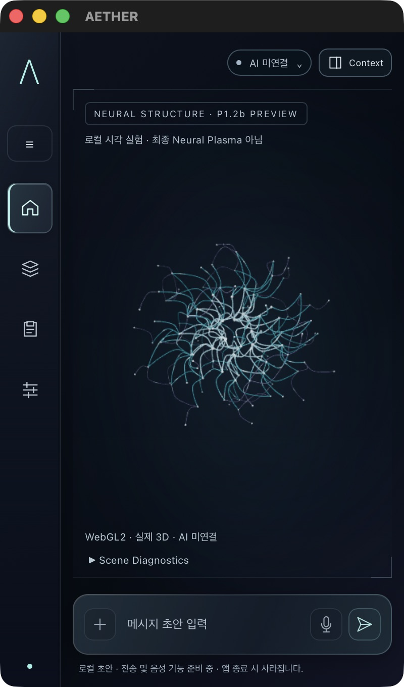
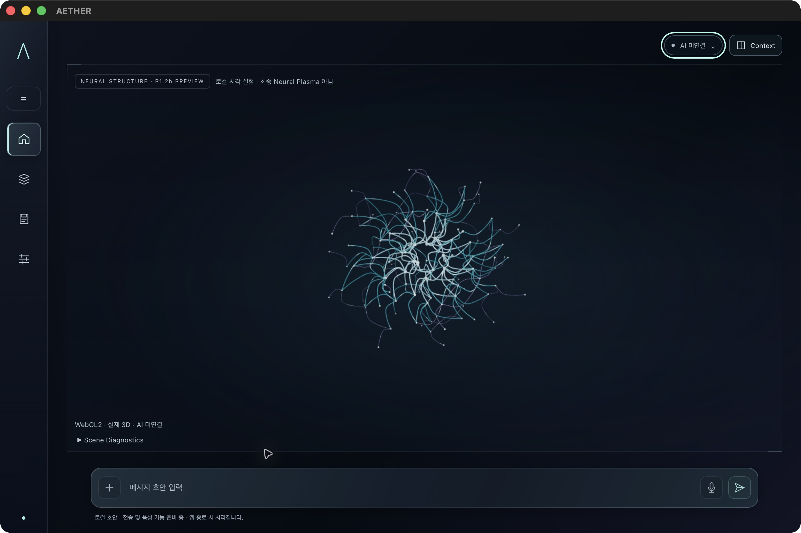
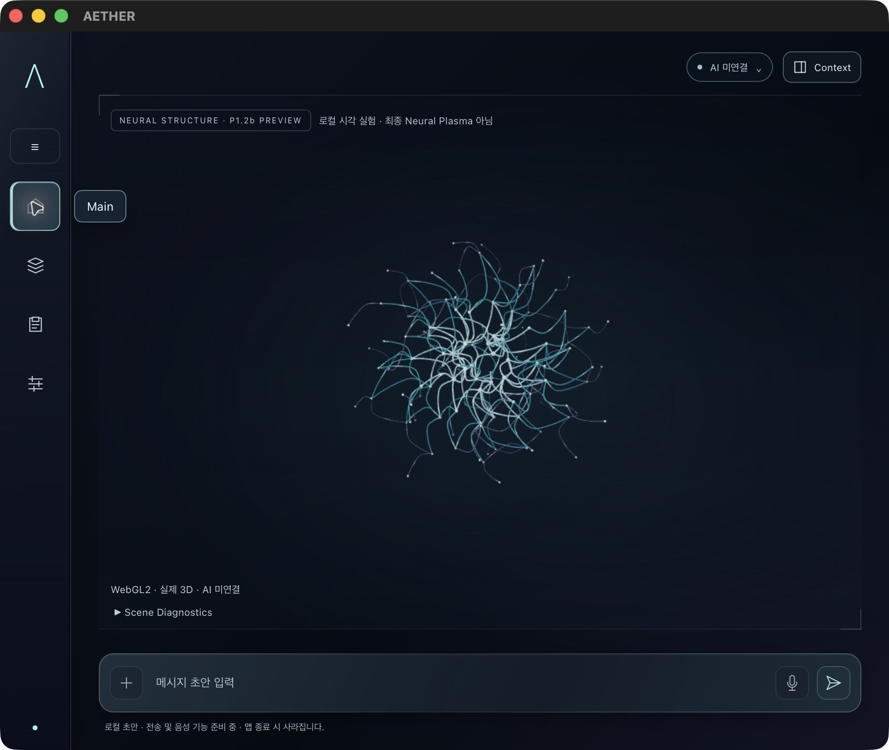
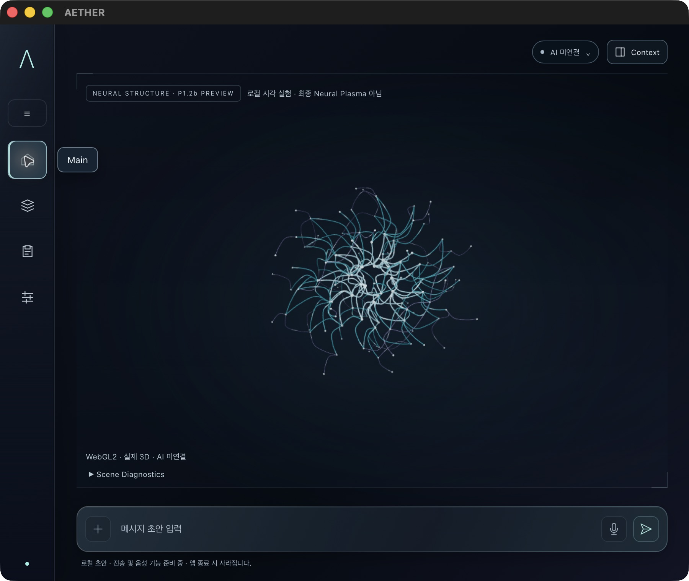
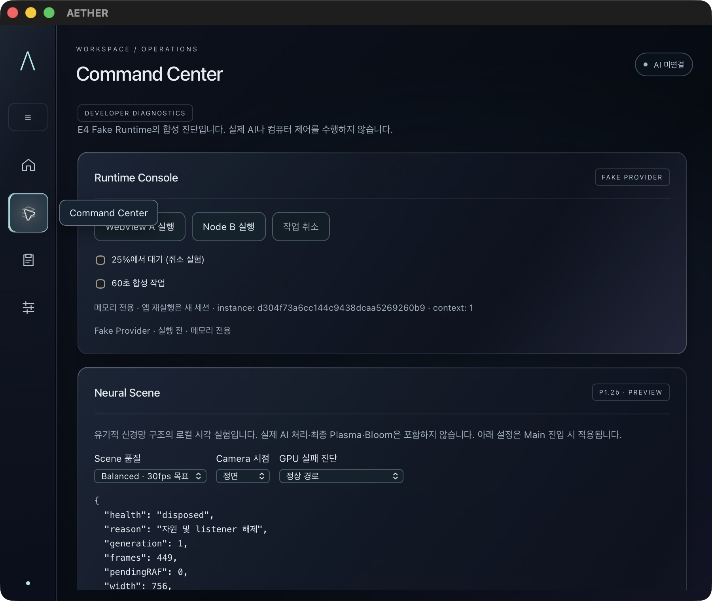
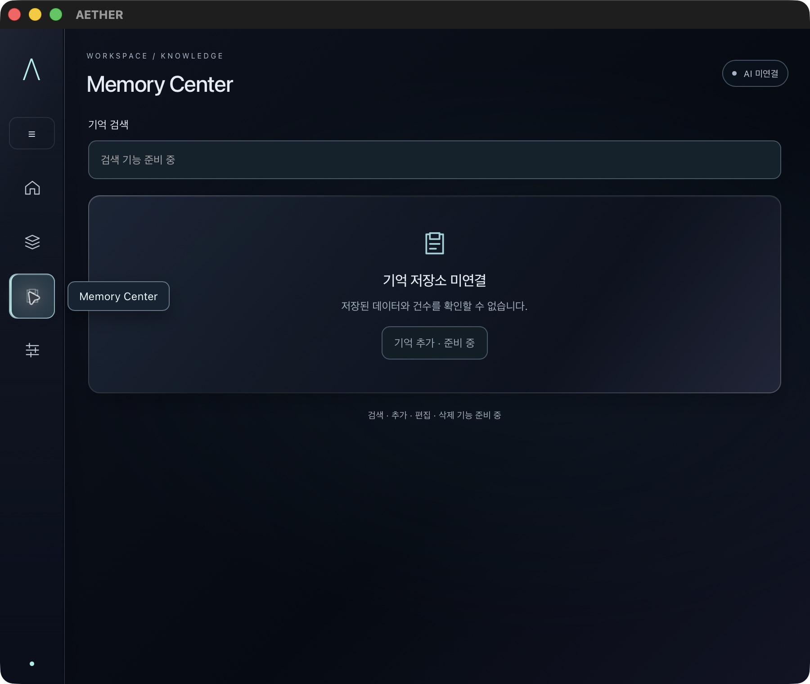
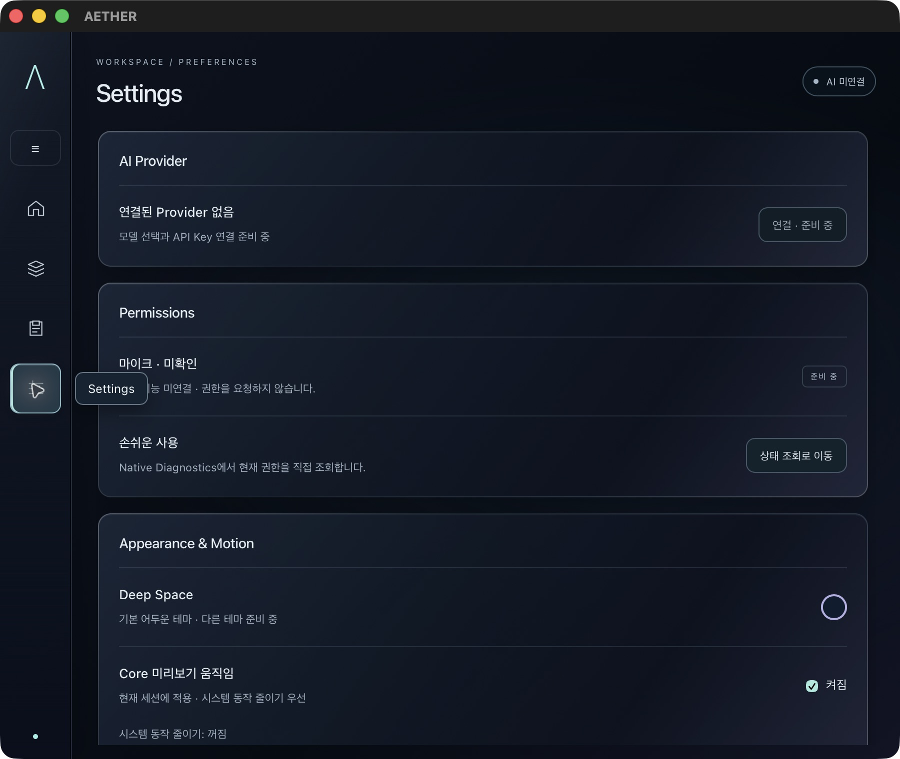
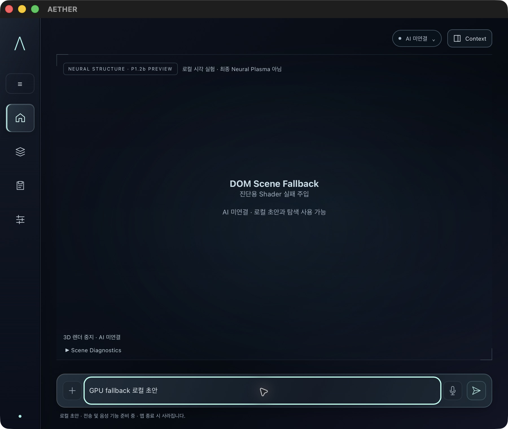

# P1.2b Living Neural Intelligence Core

Refs #36. 기준 main `c74ba28b0a4afefb97de45c6e29610ff0239a4ab`.
P1.2a #32 / PR #33 Foundation 구조·동작 승인과 병합은 완료됐다.
이번 사용자 지시는 **새 시각 요구에 따른 b 구현 승인**이며 실제 결과의 시각 승인/병합 승인은 아니다.

## 설계 변경과 합격 기준

기존 [설계](p1-2-spatial-interface-design.md)의 두꺼운 금속 궤도, 레일, 패널 이음새 중심 b를 대체한다.
그 이유는 사용자가 기계 내부 AI보다 지능 자체가 살아 있는 유기적 3D 구조로 보이길 원하기 때문이다.
기계식 Reactor, 원자 모형, 단순 회전 구체는 합격 기준이 아니다. 이전 문서는 변경 이력을 위해 보존한다.

- 중심이 밀집되고 외곽으로 가지가 분산되는 실제 3D 곡선과 여러 깊이의 접합 노드.
- 정면/±15°에서 앞뒤 연결과 가림이 보이고, 정적인 상태에서도 구조가 이해될 것.
- 전체 회전 대신 제한된 연결 방향 에너지 전파·노드 광량 변화·작은 연속 변형으로 생동감 표현.
- 청백색 중심, Cyan/Ice Blue 신경망, 낮은 채도 Violet 외곽. 얇은 외곽 에너지 필드는 선택 사항이며
  이번에는 별도 닫힌 궤도를 넣지 않아 중앙 신경망에 집중한다.
- 900×760 / 400×680 / 1200×800의 Navigation·Context·Status·Dock 안전 영역 유지.
- 실제 AI는 미연결. 자동 움직임은 로컬 시각 실험이며 listening/thinking/speaking은 Preview로만 표시.
- 실제 패키징 앱을 사용자가 검토해야 한다. Node/CI 성공은 미술 품질 승인이나 최종 Plasma 완성을 뜻하지 않는다.

## 코드와 자원 소유권

`scene/neural.ts`가 고정 seed 기반 4층 노드와 부모/주변 연결을 생성한다. CatmullRom 곡선을 실제 TubeGeometry로
만들어 중심/중간/외곽 및 접합 노드 4 batch로 결합한다. 생성 중 임시 geometry는 finally에서 dispose한다.
반복 frame에는 새 Mesh/Geometry/Material/Buffer를 생성하지 않는다. 모든 연결과 노드가 같은 연속 변위장을
사용하므로 접합이 분리되지 않는다. 최대 변위를 포함하는 bounding sphere는 기존 Camera 예산 안에 둔다.

Opaque depth-tested ShaderMaterial이 각 면의 기본 음영과 중심/앞뒤 밝기를 계산한다. texture, render target,
Bloom, raymarching, 외부 자산은 없다. 이는 b의 경량 표면 표현이며 최종 물리 조명/반사·Plasma가 아니다.
시간·에너지·속도 uniform만 변경하며 renderer 시간은 실제 animation frame에서만 진행한다.
숨김에서 돌아올 때 경과 시간을 따라잡지 않고, Motion OFF/reduced-motion은 현재 형태를 고정한다.

Renderer의 소유 배열에 최종 geometry/material을 등록하고 기존 release에서 해제한다. Neural invalidate는
후속 update를 차단한다. 단일 canvas/WebGL2 context, ResizeObserver/RAF/dispose, VisualGate·session 소유권을 유지한다.
`geometryBytes`는 CPU 측 buffer byte 합계이며 실제 VRAM/RSS가 아니다. 계약 harness의 draw 통계는 GPU 실측이 아니다.

## c/d/e 확장 경계

- c: 같은 Core local 좌표와 `neuralEnvelope.plasmaRadius` 안에 실제 volumetric density를 통합한다.
  b의 튜브를 volume 표면 무늬로 대체하지 않고 앞/내부/뒤 가림을 검증한다. 최종 raymarching은 이번에 구현하지 않는다.
- d: 제어된 Bloom, 고급 조명과 공간 환경을 별도로 검토한다. 금속 Reactor를 새 요구와 상충되게 복원하지 않는다.
- e: `neuralPalette`와 승인된 시각 상태에서 DOM의 공통 palette/energy를 도출한다.
  현재는 네 화면을 재디자인하거나 frame마다 React/DOM을 갱신하지 않는다.
- 읽기 전용 Visual State만 소비하며 실제 AI·음성·Runtime·승인·컴퓨터 제어 기능을 소유하지 않는다.

## 검증·보호·사용자 게이트

새 의존성 없음. Three 0.187.0 및 기존 addons의 geometry 결합 유틸리티만 사용한다.
package/lockfile, Rust/Swift/Node/IPC/CSP/capability/계측 변경은 제외한다.
P0 E5b PARTIAL, #34 Draft / #27 OPEN, Worktree·고정 앱·측정 결과 보존.
빌드/GUI 전 측정 process 부재를 읽기 전용 확인하며 재개 시 무거운 작업 중지.
별도 `target/p1-2b-issue-36`를 사용해 P1.1 및 P1.2a 앱·캡처를 보존한다.

Node의 geometry 유한성/3D 범위/예산/결정성/버퍼 불변과 기존 adapter/lifecycle·Runtime 회귀,
TypeScript production build, Rust 회귀, 실제 arm64 앱 세 크기·시점·motion·fallback·네 화면·Quit을 구분한다.
StrictMode 순서의 계약 검사는 실제 React scheduler 검사가 아니다.
후속 #35의 실제 WKWebView 복원 후 재초기화 실패는 NOT_RUN으로 유지한다. 공유 WebKit process 종료 금지.
GPU time·실제 VRAM·귀속 RSS 미수집은 UNAVAILABLE, 장시간 성능·전력·VoiceOver 미실행은 NOT_RUN이다.
Balanced30/High60/DPR1.25/1.5 및 draw≤60/triangle≤150k는 목표이며 관찰한 지표만 별도 보고한다.

실제 source SHA, 앱 경로, bundle hash, 캡처와 수행 결과는 Draft PR/최종 검증 기록에 갱신한다.
사용자 실제 앱 Living Neural Intelligence 시각 승인 후에도 최신 HEAD squash merge 승인은 별도다.
P1.2c를 자동 시작하지 않는다.

P1_2B_VISUAL_APPROVED: NO
FINAL_AETHER_VISUAL_APPROVED: NO
MAIN_MERGED: NO
NEXT_PHASE_STARTED: NO


## 구현 검증 기록 · 2026-11-12

macOS 26 / Apple Silicon에서 production arm64 앱을 직접 실행했다. 별도 target을 사용했으며
앱 코드 변경을 마친 후 패키징하고 아래 검증 동안 앱 입력을 변경하지 않았다.
최종 커밋과 검증 입력의 파일별 SHA-256 비교, 전체 source SHA 및 CI는 PR에 기록한다.
앱/원시 AX 로그는 커밋하지 않으며 아래 비식별 앱 화면만 리뷰 증거로 포함한다.

| 검사 | 결과 | 근거와 한계 |
| --- | --- | --- |
| TypeScript / Vite production / pinned Node sidecar build | PASS | JS 810.09 kB / gzip 219.56 kB, 기존 500 kB chunk 경고 유지 |
| Node 23 tests | PASS | Runtime 8 + Foundation 5 + SceneHost 계약 7 + neural geometry 3 |
| Rust 19 tests | PASS | release / locked / offline, ledger·취소·sidecar·lifecycle 회귀 |
| arm64 앱 패키징 | PASS | Mach-O arm64, 앱 파일 합 122,218,369 bytes |
| 실제 WKWebView neural Shader / WebGL2 | PASS | 4 draw calls, 56,640 triangles, 단일 live Renderer |
| 실제 앱 Main / Command / Memory / Settings | PASS | 화면 전환과 AX 본문 존재 확인, 미연결 상태 유지 |
| 900×760 / 400×680 / 1200×800 | PASS | Main Scene/Dock 미간섭, 최소 창 6행 초안은 최대 높이 안에서 내부 스크롤 |
| 정면 / ±15° | PASS | 실제 Camera 변경 캡처, 서로 다른 깊이의 연결 가림 확인; 미술 품질 승인은 별도 |
| Motion ON / OFF | PASS | ON uniform 기반 변형/전파, OFF frames 1 / RAF 0 고정 |
| 시스템 reduced-motion | PASS | macOS 설정 ON에서 단발 렌더/RAF 0, 검증 후 원래 OFF 복원 |
| 숨김 / 최소화 / Main 이탈 | PASS | 숨김·최소화 RAF 0; 최소화 복원은 도구 입력 한계로 사용자 Dock 클릭 후 RAF 1 확인 |
| Main ↔ Command 20회 왕복 | PASS | 매 이탈 liveRenderers/geometries/materials/pendingRAF 0, created=disposed |
| context loss → restore | PASS | 자체 canvas 확장으로 fallback 전환 후 새 generation 1 live Renderer, Motion OFF 유지 |
| 진단 Shader 실패 → DOM fallback | PASS | 초기 capability probe 실패 주입, 로컬 초안/Navigation 유지, 정상 설정으로 복귀 |
| 키보드 / Context·Status / Focus | PASS | Tab·Return 화면 이동, Esc 닫기와 실행 버튼 Focus 복귀, 최소 창 Dock 미가림 |
| Runtime A/B·Native | PASS | A/B succeeded, B cancelled/reaped, native 승인 카운터 0→1, macOS26·AX 미허용 조회 |
| reload / Quit | PASS | 같은 app instance에서 context epoch 1→2, 카운터 1 유지; 정상 Quit 후 소유 PID 부재 |
| StrictMode/stale callback/restore 실패 계약 | PASS | 실제 SceneHost 코드를 harness의 React/WebGL 대역으로 실행; 실제 React scheduler/GPU 증거 아님 |
| 실제 복원 후 재초기화 실패 / WebKit process crash | NOT_RUN | 후속 #35 유지, 공유 WebKit 프로세스를 종료하지 않음 |
| GPU time / 실제 VRAM / 귀속 RSS | UNAVAILABLE | CPU geometry buffer나 submit 시간을 대체 지표로 주장하지 않음 |
| 장시간 성능·전력·VoiceOver·실제 개발 StrictMode 재실행 | NOT_RUN | 이번 production GUI/계약 테스트의 범위 밖 |
| 연속 동영상 | NOT_RUN | 실제 연속 스크린샷 8장과 시각만 로컬 보존, 연속 녹화로 주장하지 않음 |

Balanced 관찰 구간은 2,335 frame interval samples에서 p95 34 ms, CPU submit p95 1 ms였다.
이는 GUI 탐색 중의 제한된 관찰이며 독립 벤치마크나 30fps 장시간 보증이 아니다.
High의 DPR 1.5 / 목표 60fps 설정을 실제 확인했으나 60fps 성능 합격으로 판단하지 않는다.
이 결과는 향후 volumetric Plasma 비용을 보증하지 않으며 P0 E5b 결과와 혼합하지 않는다.

실행 명령(저장소 루트 기준):

```sh
npm --prefix apps/desktop run typecheck
cd apps/desktop
node --experimental-vm-modules --experimental-strip-types --test tests/neural-structure.test.mjs tests/scene-lifecycle.test.mjs tests/scene-foundation.test.mjs tests/fake-provider.test.mjs tests/sidecar-protocol.test.mjs
```

다음 명령은 저장소 루트에서 실행했다. 도구 PATH에 Cargo bin을 추가했으며 설치는 수행하지 않았다.

```sh
CARGO_TARGET_DIR="$PWD/target/p1-2b-issue-36" cargo test --release --manifest-path apps/desktop/src-tauri/Cargo.toml --locked --offline
CARGO_TARGET_DIR="$PWD/target/p1-2b-issue-36" CARGO_NET_OFFLINE=true NODE_ENV=production npm_config_ignore_scripts=true npm --prefix apps/desktop run tauri -- build --bundles app --no-sign -- --locked --offline
python3 scripts/validate_governance.py
git diff --check
```

앱 상대 경로: `target/p1-2b-issue-36/release/bundle/macos/AETHER.app`.
Bundle SHA-256: `919b1bbf652825981a98d5536b4bc5ba8d0d206d651cc18f4b20b8e1e339ce63`.
해시 정의: 8개 일반 파일을 bundle 상대 경로 순으로 정렬한 `SHA256  relative/path\n` UTF-8 manifest의 SHA-256.
배포용 signing/notarization은 수행하지 않았다. 로컬 `qa/verified-build-inputs.json`과 `bundle-manifest.sha256`을 보존한다.

### 실제 앱 화면

캡처는 같은 앱 코드 입력에서 얻은 실제 패키징 앱 결과다. Minimum/Wide는 정적 Motion OFF 상태다.
최종 Plasma·Bloom·공간 조명 또는 사용자 시각 승인 증거로 해석하지 않는다.

| 기본 900×760 | 최소 400×680 | 넓은 1200×800 |
| --- | --- | --- |
|  |  |  |

| Camera −15° | Camera +15° | Motion OFF |
| --- | --- | --- |
|  |  |  |

| Command | Memory | Settings |
| --- | --- | --- |
|  |  |  |



P1 앱의 PID·시작 시각·실행 경로를 대조하고 정상 Quit 후 소유 앱/sidecar/빌드/테스트 process 0을 확인했다.
P0나 사용자 앱을 종료하지 않았다. E5b source·계측·raw 자료 및 P1.1/P1.2a 고정 앱을 수정하지 않았다.
검증 종료 후 추가 P1 빌드·GUI 실행은 중지한다.

## 후속 시각 리뷰

위 ed30216 결과는 사용자 시각 승인을 받지 않았다. [Neural Nucleus 개선과 새 검증 기록](p1-2b-neural-refinement.md)을 참고한다. 기존 캡처·앱·측정 수치는 비교 기준으로 보존한다.
