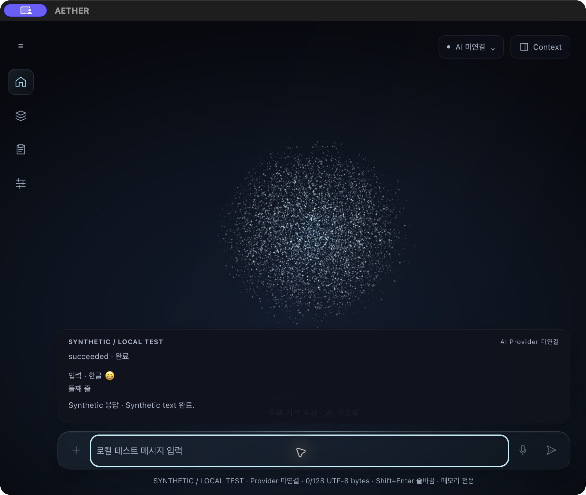
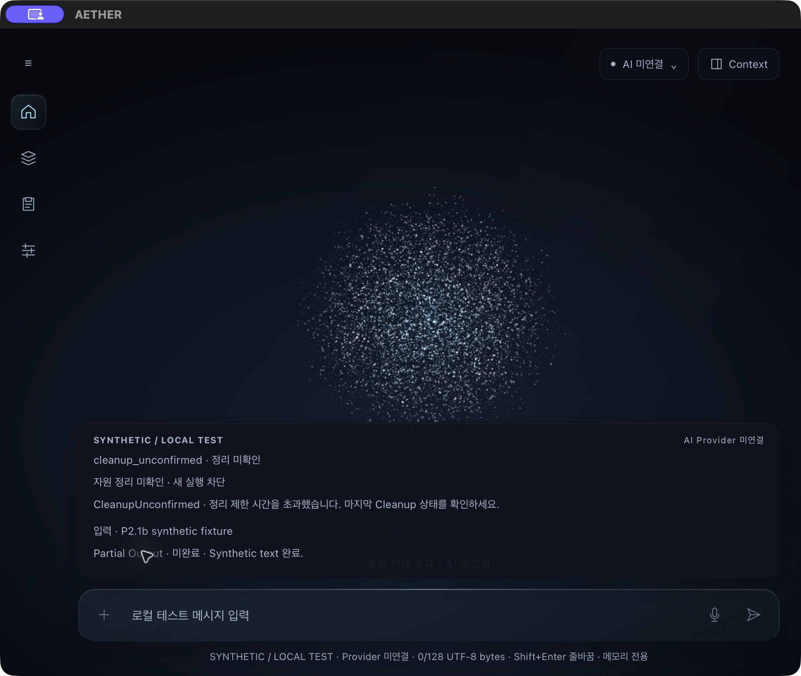

# P2.1c Command Dock Synthetic Conversation

[Issue #52](https://github.com/Kim-Ji-Won/AETHER/issues/52) · base main `ef5215f09c20675a193a7b58f096bfdabe73bcfd` (PR #51 Squash Merge)

## 범위와 구현

사용자가 승인한 P2.1c는 기존 Command Dock을 P2.1b의 WKWebView / Rust Host에 연결하는 **Synthetic 전용 개발 UI**다. 실제 AI 답변, 전역 Runtime A 선정, P0 완료 또는 P2.2 착수가 아니다. 기존 P2.0 계약과 P2.1a/b 구현을 재사용한다. P0 #44 / Draft PR #45의 E5b/E5c PARTIAL과 ADR 001 PROPOSED를 유지한다.

`Shell → useAgentConversation (단일 AgentRuntime) → 기존 Tauri agent.text.v1 IPC → Lifecycle Gate → Rust Host / SyntheticAdapter`

- Shell 수명의 controller, bootstrap, snapshot poller를 Main Dock과 Command Center Diagnostics가 공유한다. 페이지 이동은 producer를 취소하지 않는다. React StrictMode의 중복 effect setup은 같은 bootstrap promise를 공유한다. Diagnostics의 검증 모드/IPC oracle은 그대로 사용한다.
- Start에는 실제 입력 text를 전달한다. Synthetic 출력은 기존 고정 조각 `Synthetic ` / `text ` / `완료.`이며 입력에 대한 AI 추론이 아니다. FakeRun A/B의 25/50/75 progress와 분리한다.
- UI는 Rust snapshot 전체를 교체한다. 동일 host의 epoch/generation/revision/high-water 역행, 동일 revision 중복, run/identity/sequence 역행, terminal/state/output/error 변조를 거부한다. 거부한 snapshot을 producer 제어에 반환하지 않는다. Start 응답은 요청 identity를 확인한 뒤 사용한다.
- Rust가 admission, run state, terminal, cleanup, monotonic deadline의 최종 소유자다. 기존 Bootstrap 0→wire 1 매핑, sender/lease 검증, Gate, 5개 IPC, timeout driver를 변경하지 않았다.
- UI의 `reconnecting` / `disconnected`는 transport 관찰 상태다. 마지막 Host 상태와 구분하고 성공/실패를 임의로 만들지 않는다. 연결 다시 확인은 bootstrap/snapshot만 수행하며 Start를 재전송하지 않는다.
- Reload는 기존 정책대로 RuntimeLost를 표시하고 새 bootstrap에서 Host snapshot을 읽는다. 입력 초안과 제출 text는 메모리에만 있으며 Reload/앱 재시작으로 사라진다. 대화 이력 저장이나 자동 복구/재시도는 없다.

## 입력 / 취소 / 표시

Rust의 **128 UTF-8 bytes** 정책을 유지했다. 기존 textarea `maxLength=4000`은 128 UTF-16 code units의 보조 상한으로 좁혔다. 실제 UI 판정은 TextEncoder의 UTF-8 byte 수이며 Host가 다시 검증한다. ASCII 128, 한글 42자+ASCII 2자, emoji 32개가 128 bytes다. byte 초과를 자동으로 잘라 전송하지 않는다. 공백만 있는 입력은 거부한다.

Enter는 제출, Shift+Enter는 줄바꿈이다. composition 상태, native `isComposing`, Safari keyCode 229, compositionend 직후 Enter, key repeat를 걸러낸다. 동기 submit latch와 controller의 starting/producer guard가 중복 요청을 막고, Host도 request identity를 검사한다. 전송이 확인된 초안만 비우며 그 사이 수정된 초안은 보존한다. 첨부/마이크는 disabled다.

응답 패널은 Dock 바로 위의 제한된 높이 overlay이며 state, 입력/출력, safe error, Cancel을 구분한다. 성공 전 출력에는 `Partial Output · 미완료`를 표시한다. `SYNTHETIC / LOCAL TEST`, `AI Provider 미연결`을 명시한다. CancelRequested는 Cancelled와 다르고 Pending/Unconfirmed cleanup 동안 새 Start를 막는다. 늦은 ACK가 cleanup을 확인해도 Failed/error/partial output을 성공으로 바꾸지 않는다. 초기 GUI 검증에서 발견한 “늦은 ACK 이후에도 차단 안내가 남음”은 오류 이력과 현재 cleanup 차단 안내를 분리해 수정했다.

기존 Dock의 geometry/spacing/typography/glass CSS, Particle shader/geometry/animation, navigation 구조를 변경하지 않았다. 새 CSS는 wrapper의 overlay 기준점과 응답 패널에만 적용한다. 한 줄 안내문과 기존 textarea 자동 높이 조절을 유지한다. 응답 overlay는 기존 시각 효과 설명 일부를 덮을 수 있으며 Particle를 AI speaking/listening 상태에 연결하지 않는다. 상태만 polite live region으로 알리고 출력 영역은 별도로 키보드 focus/scroll 가능하게 한다. 실제 VoiceOver 전체 사용성 승인을 의미하지 않는다.

## 자동 검증 (2026-11-16 KST)

| 검사 | 결과와 범위 |
|---|---|
| Rust `cargo test --manifest-path apps/desktop/src-tauri/Cargo.toml --locked --offline` | **PASS 79**: Host 46 + bridge 14 + 기존 regression 19 |
| Host 입력 검증 추가 | UI를 우회한 empty/공백, ASCII/한글/emoji 128-byte 경계 및 초과 거부; 실패 시 snapshot 불변 |
| `npm run typecheck` | PASS; 최종 패키징에도 포함 |
| Frontend 기존/신규 pure contract | PASS 20: AgentRuntime 5, conversation policy 7, Fake Provider 5, real Node sidecar 3 |
| 기존 Scene / Particle / Neural 회귀 | PASS 32: DOM/GPU double 기반 계약 검사, 실제 GPU 성능 증거 아님 |
| React SSR 렌더링 | PASS 4: input/output HTML escape, 상태/partial 구분, 늦은 cleanup 후 오류 이력/차단 구분, accessible Dock/disabled controls |
| Frontend 합산 | **PASS 56**, 서로 다른 테스트 항목 합산. 기존 52개와 최종 React SSR 4개 |
| network-denied 실행 | PASS 60: 이미 빌드한 Host 46 + bridge 14를 `(deny network*)` sandbox에서 실행 |
| unsigned release App Bundle | PASS; pinned Node/완전한 LICENSE 검사 포함. 기존 large chunk 경고는 남음 |
| Governance / whitespace | PASS: `python3 scripts/validate_governance.py` 21 artifacts, `git diff --check` |

Frontend 명령:

```sh
cd apps/desktop
node --experimental-strip-types --experimental-vm-modules --test tests/*.test.mjs
node --experimental-strip-types --experimental-vm-modules --test tests/conversation-render.test.mjs
```

전체 Frontend 첫 실행에서 SSR 검사가 Vite 임시 캐시 쓰기 sandbox 권한 때문에 실패했다(나머지 52 PASS). 권한을 허용한 SSR 재실행 3 PASS 이후, 발견된 Cleanup 안내 오류의 regression test를 추가하여 최종 SSR 4 PASS를 확인했다. 최초 TypeScript 검사에서 admission payload/narrowing 타입 오류를 수정한 뒤 typecheck와 build가 통과했다. 실패한 시도를 PASS로 합산하지 않는다. 의존성/lockfile 변경과 registry 다운로드 없이 동일 lockfile의 기존 Worktree 캐시와 hash가 검증된 Node를 복사했다.

패키징 명령:

```sh
CARGO_NET_OFFLINE=true npm run tauri -- build --bundles app --no-sign -- --locked --offline
```

## 최종 Packaged macOS 검증

macOS 26.6 / arm64, 실제 packaged WKWebView 앱의 native AX/메뉴/키보드 조작과 screenshot으로 확인했다. **아래 표와 7개 screenshot은 모두 최종 executable SHA-256 `1c2f4b695fd6f1408ebd3617db04b69c9dbfd2396c0b41febd62bd20fe3a1d7c` 기준**이다. 수정 전 bundle `35aa78f473c279a1b7dcd085d30a46087366af75f7b5bc0a06397463d6f00173`의 GUI 결과는 이 표에 합산하지 않는다. GUI 검증 후 앱을 종료했고 bundle을 다시 빌드/변경하지 않았다. unsigned 개발 bundle이며 signed/notarized release가 아니다.

| 실제 관찰 | 결과 |
|---|---|
| 빈 초안/공백 | 빈 Send disabled. 공백 3 bytes + Enter에서 Start 없음, 공백 안내 |
| UTF-8 경계 | 한글 43자 =129/128, Send disabled. emoji 32개=128/128 수락 |
| Enter 중복 | emoji 입력에 Enter 두 번 → run 1만 생성, Succeeded/terminal1/Confirmed |
| 한글/emoji/줄바꿈/Focus | `한글 😀` + Shift+Enter + `둘째 줄`; newline 유지. Tab은 disabled 첨부/마이크를 건너 Send로 이동. Enter 제출 후 textarea focus, run 2 Succeeded/seq6/terminal1/Confirmed |
| queued 취소 | Diagnostics→Main에서 queued 표시. run 3 Cancelled/seq3/terminal1/NotRequired, 가짜 cleanup ACK 없음 |
| running 취소/페이지 이동 | Diagnostics의 Run Timeout 모드→Main에서도 run 4 진행. Main Cancel 후 Cancelled, 부분 출력 유지; 별도 controller 생성 없음 |
| CancelRequested / cleanup pending | Cleanup ACK 누락 fixture run 5를 Main에서 취소. `cancel_requested`, disabled Cancel, Partial Output 관찰 |
| cleanup 미확인 / 늦은 ACK | run 5 Failed/CleanupUnconfirmed/Unconfirmed와 새 입력 Send 차단. 늦은 ACK 후 seq7/terminal1/Failed/error 유지, Confirmed. Main에서 유효 초안 Send enabled, 차단 문구 사라짐 |
| Reload / snapshot | run 6 진행 중 Cmd+R. RuntimeLost/Failed/terminal1/Confirmed, partial 유지, 입력 초안 제거. UI epoch 2→3(wire), generation3. 자동 Start 없음 |
| idle deadline | run 7 Failed/IdleTimeout, Main에 safe error 표시 |
| IPC 회귀 | run 8–10: duplicate Start, wrong lease, wrong attempt, duplicate Event, late Delta/Completion, duplicate Cancel/terminal, seq gap, unsupported content 총 9 oracle PASS |
| run deadline | run 11: native sheet를 포함한 실제 앱 작업 중 Rust deadline 진행. Failed/RunTimeout/seq14/terminal1/Confirmed, 11개 partial delta 유지 |
| FakeRun A/B | A run1 / B run2 각각 FAKE_OK/terminal1, B exit0/reaped. Agent Text와 분리 |
| Native Approval | sheet 취소→counter0, 새 요청 1회 승인→counter1 |
| HTML 입력 | run 12의 `<script>alert(1)</script>`가 문자로 표시, 정상 Synthetic 응답. alert/HTML 실행 없음. 출력 공격 문자열은 별도 React SSR escape 검사로 검증 |
| Quit / 재시작 | run 13 Running에서 Cmd+Q 후 실행 앱 목록에서 소멸. 재시작은 새 instance/Run 없음/counter0. 이전 instance snapshot 거부 PASS(Lifecycle Gate). 최종 Quit 후 앱 없음 확인 |
| Particle / Dock | 최종 screenshots에서 기존 Orb/Dock/nav 유지, 실제 Main 788×511 viewport / projectionZoom1.12. navigation 이후 Particle dispose를 Diagnostics에서 관찰. 성능/장시간 leak 판정 아님 |

### PASS / FAIL / NOT_RUN 경계

- 최종 관찰 표에서 남은 FAIL 없음. 수정 전 Cleanup 안내 오류와 초기 검사 실패는 위 이력에 기록했다.
- **실제 물리 키보드 한국어 IME 조합: NOT_RUN.** native 도구에서 한글/emoji 입력과 입력기 전환은 가능했으나 r/k 키 호출이 연속 조합 대신 별도 자모로 들어가 실제 조합 동작을 재현하지 못했다. composition/isComposing/229/end-order/repeat guard는 결정적 테스트 PASS다. 사용자 IME 수동 검증이 남는다.
- **실제 VoiceOver 탐색/낭독, 다양한 창 크기/디스플레이, disconnected/reconnecting 장애 주입: NOT_RUN.** AX label, Tab/Enter/textarea focus와 해당 상태의 SSR/policy 검사는 PASS다.
- Snapshot revision/identity 역행은 자동 계약 검사 PASS이며 packaged 앱에 변조 snapshot을 주입하지 않았다. 앱의 정상 snapshot 공유와 Reload 재동기화만 실환경 PASS다.
- P2.0 C01–C12/I01–I12/E01–E15의 기존 39개 결정적 Host fixture는 재실행 PASS. U01/U03/U05 projection/admission, U04 synthetic 표시, S02 text escape의 해당 하위 범위를 추가 확인했다. U02 event-subscription race(현재 polling), 실제 Provider credential/HTTP/청구, Runtime B Agent Integration, OS crash/direct AppKit termination, P0 전체 성능 비교, signed/notarized release는 NOT_RUN. **54/54 PASS로 보고하지 않는다.**

## 최종 화면 증거

앱 창만 캡처했고 실제 사용자 대화/자격 증명/lease/개인 경로는 포함하지 않는다. 모든 입력은 비민감 고정 test string이다. 캡처 원본 PNG를 수정 없이 보존한다.





추가: [Idle](evidence/p2-1c/01-idle.png), [Cancelled와 부분 출력](evidence/p2-1c/03-cancelled.png), [CancelRequested](evidence/p2-1c/04-cancel-pending.png), [Reload RuntimeLost](evidence/p2-1c/06-reload.png), [RunTimeout](evidence/p2-1c/07-timeout.png).

## 변경 파일 / 보안 / 후속 조건

| 파일 | 책임 |
|---|---|
| `apps/desktop/src/agent-runtime.ts` | 입력 전달/byte 검사, 공유 busy/변경 통지, bootstrap coalescing, snapshot/admission 방어 |
| `apps/desktop/src/useAgentConversation.ts` | Shell 단일 controller 및 bootstrap/polling/connection 관찰 |
| `apps/desktop/src/Shell.tsx` | shared conversation을 Dock/Diagnostics에 주입 |
| `apps/desktop/src/AgentDiagnostics.tsx` | 기존 실행/취소/오류 fixture를 shared controller에 연결 |
| `apps/desktop/src/ShellParts.tsx` | 기존 Dock input/Send/IME/byte 안내 연결 |
| `apps/desktop/src/conversation-ui.ts` | 입력 가능 조건, 키 정책, 상태/안전 오류 문구 |
| `apps/desktop/src/ConversationResponse.tsx` | Host state/partial/error/Cancel/연결 상태 text projection |
| `apps/desktop/src/conversation.css` | Dock 위 최소 응답 overlay 스타일 |
| `apps/desktop/tests/agent-runtime.test.mjs` | admission identity 검증에 맞는 fixture request high-water 정합화 |
| `apps/desktop/tests/conversation.test.mjs` | 7개 input/key/state/identity/shared admission/error 계약 검사 |
| `apps/desktop/tests/conversation-render.test.mjs` | 4개 실제 React SSR 안전 출력/표시 검사 |
| `apps/desktop/src-tauri/src/agent_runtime/tests.rs` | 기존 production Host의 UTF-8 입력 한도 검사 1개 추가 |
| 본 문서, architecture README, evidence PNG 7개 | 범위·검증·한계·시각 증거 |

**External Provider Call=0.** 변경 경로는 기존 local Tauri IPC와 고정 Synthetic producer뿐이다. API Key/Keychain/Provider SDK/network client/임의 URL/shell 실행을 추가하지 않았다. 기존 CSP/Capability, Rust production security gate, dependency lockfile을 보존했다. 입력·lease를 log/storage/telemetry로 보내지 않으며 React text node로만 표시한다. network-denied 검사는 test binary 60개 범위이며 GUI 전체를 network sandbox에서 실행했다고 주장하지 않는다. 실제 Provider 보안 검증은 하지 않았다.

main, P0, #38 및 기존 Worktree를 변경하지 않았다. 보호 대상 9개 Worktree의 HEAD/status/diff/untracked 파일 hash를 작업 전후 비교해 동일함을 확인했다. build/의존성 산출물은 이 Worktree의 ignored 경로에만 있다. P0 채팅이 측정 종료 상태임을 확인한 뒤 무거운 작업을 수행했다. E5b/E5c/ADR 및 고정 앱 원본은 이번 결과로 완료 승격하지 않는다.

P2.2에는 별도 사용자 착수 승인, P2.1c UI/IME/접근성 리뷰, Rust-owned credential/endpoint/권한 경계, Provider-specific stream/error/cancel/cleanup 계약, 비용·rate·byte·timeout 정책, 네트워크 차단/누출/불확실한 취소 검증 계획이 필요하다. WebView/Node로 key를 전달하지 않는 기존 원칙을 유지한다. P2.2 Issue/branch/Provider 호출은 시작하지 않았다. 이 변경은 Draft PR 리뷰 대기이며 Ready/merge는 별도 승인 대상이다.
