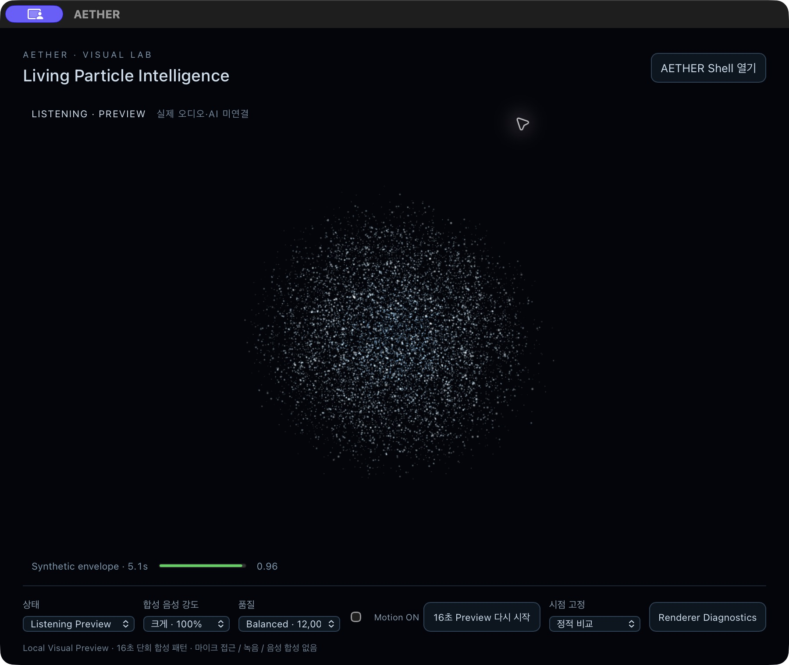
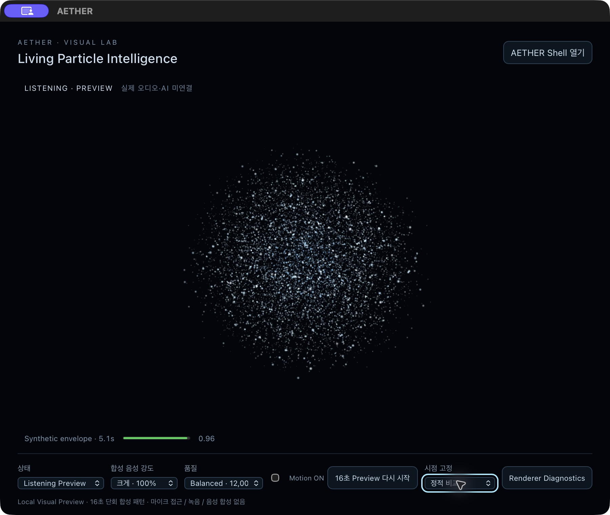
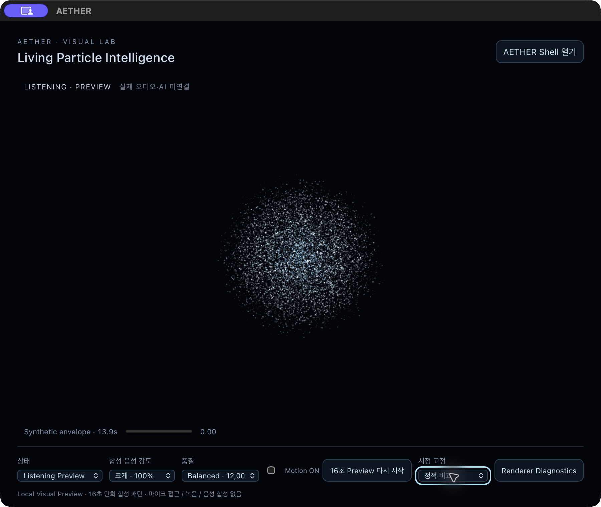
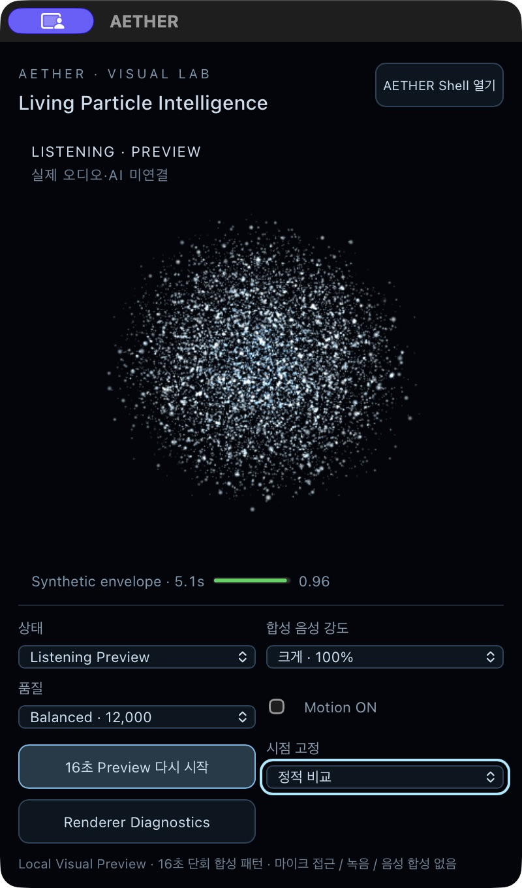
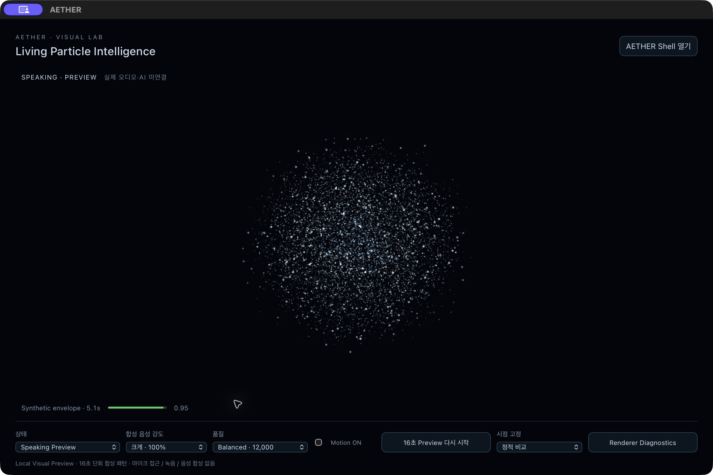
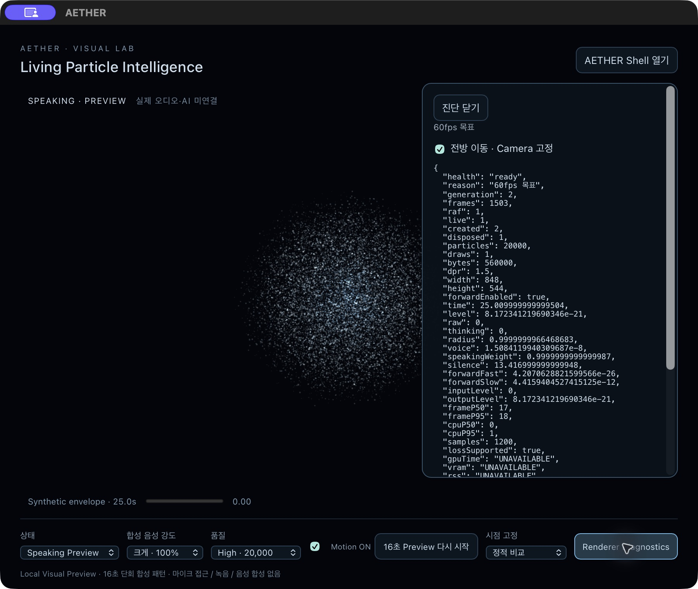

# Cinematic Particle Depth — 실제 앱 검증

Issue #39 / Draft PR #40 · 2026-11-13. 기준 main `1dc502e6380918b5e7d2b15863d807e1849365e0`.
변경 전 source `455315da72c81c05ff322939369c0c5ec962364b`. 최종 source SHA/CI는 PR 본문에 기록한다.

## 범위와 앱 식별

기존 Cyan/Ice Blue, Balanced12,000/High20,000, 미세·중간·accent 계층, static seed/buffer, 16초 envelope, radius 수축·확산을 보존했다. Lab의 motion·vertex shader·진단 토글과 테스트/문서만 수정했다. Main, SceneHost, native/Runtime/IPC/CSP/권한/의존성 변경 없음. 실제 음성/AI 연결 없음.

- 앱: worktree 기준 `target/particle-lab-39/release/bundle/macos/AETHER.app`.
- arm64 production, 로컬 `--no-sign` 앱. 배포/공증 완료가 아니다.
- bundle SHA256: `b2f7e05e6e10336cbe7db72e71926c1431cfecf8be89b9b2526a1153fd89ad77`.
- executable SHA256: `2dc8a93487adb3012d0eb496cbab95f1dda91123359eae06a526968f0f5c84a7`.
- hash: 각 bundle 파일 SHA256을 relative-path 사전으로 정렬 JSON 직렬화한 값의 SHA256. read-only artifacts helper로 확인, benchmark 실행 없음.
- 이전 앱: `target/particle-lab-39/before-forward/AETHER.app`; 이전 bundle `b452f23b83f372210c2d377e541003d8074c1616c04b1e58d77d2ec5aaad5e2b` 불변.
- 로컬 증거: 전용 target `qa/depth/`에 build/Node/Rust 로그, source-inputs, bundle, model-audit 보존. 원본 AX와 절대 로컬 경로는 저장소에 올리지 않는다. 패키징 이후 production 입력은 동일하다. 후속 변경은 테스트 assertion 및 문서·캡처뿐이며 재빌드하지 않았다.

## 같은 Camera의 전후 비교

900×760 / canvas848×544 / Balanced / gain100% / Listening5.05s / Motion OFF. seed, Camera, envelope와 시간 적분이 동일하다. OFF는 추가 Z 변위만 0으로 하며 이전 동작을 재현한다. 별도로 보존한 이전 앱의 동일 시점 캡처와도 비교했다. 기존 fragment 색상·size/alpha 수식은 수정하지 않았다.

| 전방 OFF — 기존 변형 | 전방 ON — 추가 view-space Z |
| --- | --- |
|  |  |

| 긴 쉼 13.9s | 최소 창400×680, 강한 발화 |
| --- | --- |
|  |  |



세 크기에서 실제 창 캡처를 확인했다. Particle Volume과 조작부의 잘림을 관찰하지 않았다. 실시간 모든 시점/모든 display의 clipping을 보증하지 않는다. 전방 확대가 충분히 입체적으로 느껴지는지는 사용자 리뷰 대기다.

## 실제 연속 영상

실제 WKWebView 창을 JPEG+AX로 연속 수집하고 캡처 시각을 보존한 MP4로 인코딩했다. 프레임 보간/가상 렌더 없음. 약11~12fps의 불균일 캡처이며 30/60fps 매 프레임 녹화가 아니다. 재생 버튼 입력과 첫 캡처 사이 약0.5~0.7s는 기록되지 않았다. 16초 단회 패턴을 약16.5s까지 관찰했으나 빠진 시작 구간을 기록했다고 주장하지 않는다.

| 기록 | 프레임 | 실제 첫/끝 간격 | 앱 표시 시작/끝 |
| --- | ---: | ---: | --- |
| Listening ON | 193 | 16.003s | 0.5→16.6s |
| Listening OFF | 189 | 15.816s | 0.6→16.5s |
| Speaking ON | 190 | 15.832s | 0.7→16.5s |
| Speaking High | 179 | 15.944s | 0.5→16.6s |

Listening/Speaking ON과 Listening OFF MP4는 로컬 리뷰 산출물로 제공한다. 실제 프레임 변화와 컨트롤 상태를 확인하고 MP4를 AVFoundation으로 디코딩했다. 부드러움·시네마틱한 입체감의 최종 미적 PASS는 선언하지 않는다. 기존 전경/후경/반경 표현에 일부 입자의 원근 확대가 더해지며, 과도한 전체 확대나 화면 밖 폭발은 피했다.

## 수식 검증 — GPU readback 아님

`motion.ts`를 120Hz로 적분하고 Shader 변형을 CPU 참조로 재현했다. 동일 static seed의12,000개 중 **7,486개는 추가 전방 변위0**이다. 이 입자들도 기존 drift/접선/반경 운동은 유지한다. GPU transform feedback: NOT_RUN. 아래는 CPU 참조값이며 실제 GPU 좌표 측정값이 아니다.

| 강도 | Listening5.05s 최대 추가 Z | Speaking5.05s 최대 추가 Z |
| --- | ---: | ---: |
| 35% | 0.444 | 0.482 |
| 65% | 1.232 | 1.339 |
| 100% | 2.508 | 2.726 |

단위는 scene units. Listening100%의 최대 변위 표본 index8616은 view Z -5.712→-3.205, 원근 배율비 약1.783이다. Speaking은 같은 표본 -5.737→-3.010, 약1.906. Point size clamp 때문에 화면 크기가 이 비율과 정확히 같지는 않다.

Listening 최대 추가 Z는1s0.218, 7.95s0.0649, 13.9s0.0113으로 감소한다. 강한 발화와 독립적인 느린 복귀가 존재한다. 5.05s의 가장 가까운 입자 depth는 Listening2.839, Speaking2.641이며 near0.1보다 충분히 멀다. 해당 snapshot 최대 absNDC는0.635/0.643. 전체 수식 상한은3.136, bounding sphere5.6으로 보수적으로 포함한다. 이전37.8% 발광 픽셀 반경을 Z 변위로 사용하지 않는다.

## 검사 결과

| 검사 | 결과 | 근거와 범위 |
| --- | --- | --- |
| TypeScript/Vite 및 arm64 패키징 | PASS | production `tauri build --bundles app --no-sign -- --locked --offline`; 별도target, 기존500kB chunk 경고 |
| Node 회귀 | PASS | `node --experimental-vm-modules --test apps/desktop/tests/*.test.mjs`, 34개; 최종 assertion 보강 뒤 관련 8개 재통과 |
| Rust/pinned Node | PASS | `cargo test --manifest-path apps/desktop/src-tauri/Cargo.toml --target-dir target/particle-lab-39 --locked --offline`, 19개 |
| 전방 수식·bounded inertia·gain·rest | PASS (계약/수식) | Idle/Thinking target0, 큰/작은 반응, slow release, projection guard, seed분포, GPU측정 아님 |
| Renderer/버퍼 유지 | PASS (계약+앱) | ON/OFF 재생성 없음, stale callback/StrictMode replay/해제 계약, 실제 live1/draw1 |
| 실제 WebGL2 및 세 창 크기 | PASS | 900×760/400×680/1200×800, 실제입자·컨트롤 확인 |
| Motion OFF | PASS |31.067s 동안 frames 1626 / RAF 0 / time 5.05 유지 |
| 시스템 reduced-motion | PASS |20.065s 동안 frames 1144 / RAF 0 유지, 원래 OFF로 복원 후 RAF 1 |
| 숨김/복원 | PASS (앱 수준) |21.535s 동안 frames 54 / RAF 0 유지, Raise+진단 갱신 뒤 frames 71 / RAF 1 |
| context loss→restore | PASS | 자체 canvas, 새 generation, 이전 Renderer dispose, Motion OFF 유지 |
| Shader 실패 / DOM fallback | PASS | health unavailable / live 0 / RAF 0, 생성 3 / 해제 3; DOM controls 유지 |
| Navigation/초안/AX/Focus/Esc | PASS (제한 회귀) | Shell 네 화면 본문, 초안 유지, 진단 Esc 후 trigger 복귀, 키보드 select |
| FakeRun A/B | PASS |A1/B2 succeeded, B3/A4 cancelled, B exit/reaped |
| Native 조회 | PASS |macOS 26, AX 권한 없음 정확 표시 |
| Native 승인 sheet / reload / 최소화 재시험 | NOT_RUN (이번앱) | 이전 기준선 결과는 별도 이력. 현재 앱 PASS로 이월하지 않음 |
| 정상 Quit | PASS |PID 15784, 14:58:09 KST 시작, 전용 실행 경로 대조, 정상 Quit 후 15:08:54 프로세스 부재 |
| Governance / whitespace | PASS |21 artifacts, `git diff --check`; CI는 PR 최신 HEAD 별도 기록 |
| GPU time / VRAM / 귀속 RSS | UNAVAILABLE |frame/CPU 관찰로 대체하지 않음 |
| 장시간 전력 / VoiceOver / WebKit crash / 실제 복원 실패 | NOT_RUN |#35 유지. 계약 fallback을 실제 복원 실패 PASS로 확대하지 않음 |
| 사용자 전방 Motion 시각 승인 | 대기 |영상·앱 직접 검토 필요 |

## 비용 비교

900×760, 최근 1,200 샘플의 대화형 관찰. 격리된 장기 benchmark/P0 E5b와 혼합하지 않는다.

| 품질 | 입자 / draw | attribute bytes | DPR | 이전 frame p50/p95 | 새 frame p50/p95 | 새 CPU submit p50/p95 |
| --- | --- | ---: | ---: | --- | --- | --- |
| Balanced |12,000 /1|336,000|1.25|33/35ms|33/35ms|0/1ms|
| High |20,000 /1|560,000|1.5|17/18ms|17/18ms|0/1ms|

새 성능값에 캡처·상태 조작·Idle 구간이 포함된다. CPU 0ms는 시간 양자화 이하일 수 있다. 추가 vertex 연산과 전경 overdraw 비용이 0이라는 뜻이 아니며 장기 60fps 보증도 아니다.



## 보존 및 리뷰 방법

#38 두 기존 Neural/Plasma worktree·미커밋 소스·앱·캡처, P0 #27/#34 PARTIAL·고정 앱·raw 측정, #35는 변경하지 않았다. P0 관련 프로세스 부재를 빌드 직전 읽기 전용으로 확인했다. 설치/새 의존성/권한 변경 없음. 기존 앱과 캡처를 지우지 않았다.

앱을 열어 Listening 또는 Speaking, 강도 100%, `16초 Preview 다시 시작`을 선택한다. 같은 시점 비교는 `시점 고정` 5.05s 후 Diagnostics의 `전방 이동 · Camera 고정`을 전환한다. ON/OFF는 시계를 초기화하지 않는다. Motion OFF/reduced-motion에서는 현재 형태가 정지한다.

한계: additive point 광학은 물리적 체적 산란/DOF가 아니며, 높은 밝기로 입체감을 대체하지 않는다. 모든 이동은 Local Visual Preview다. 사용자 승인 전 Main 교체/Ready/merge/다음 단계는 진행하지 않는다.

```text
CINEMATIC_DEPTH_IMPLEMENTATION_ALLOWED: YES
PARTICLE_ORB_BASE_DESIGN_PRESERVED: YES
FORWARD_MOTION_VISUAL_APPROVED: NO
FINAL_PARTICLE_VISUAL_APPROVED: NO
AETHER_MAIN_CORE_REPLACED: NO
PR_READY_FOR_MERGE: NO
MAIN_MERGED: NO
NEXT_PHASE_STARTED: NO
```
