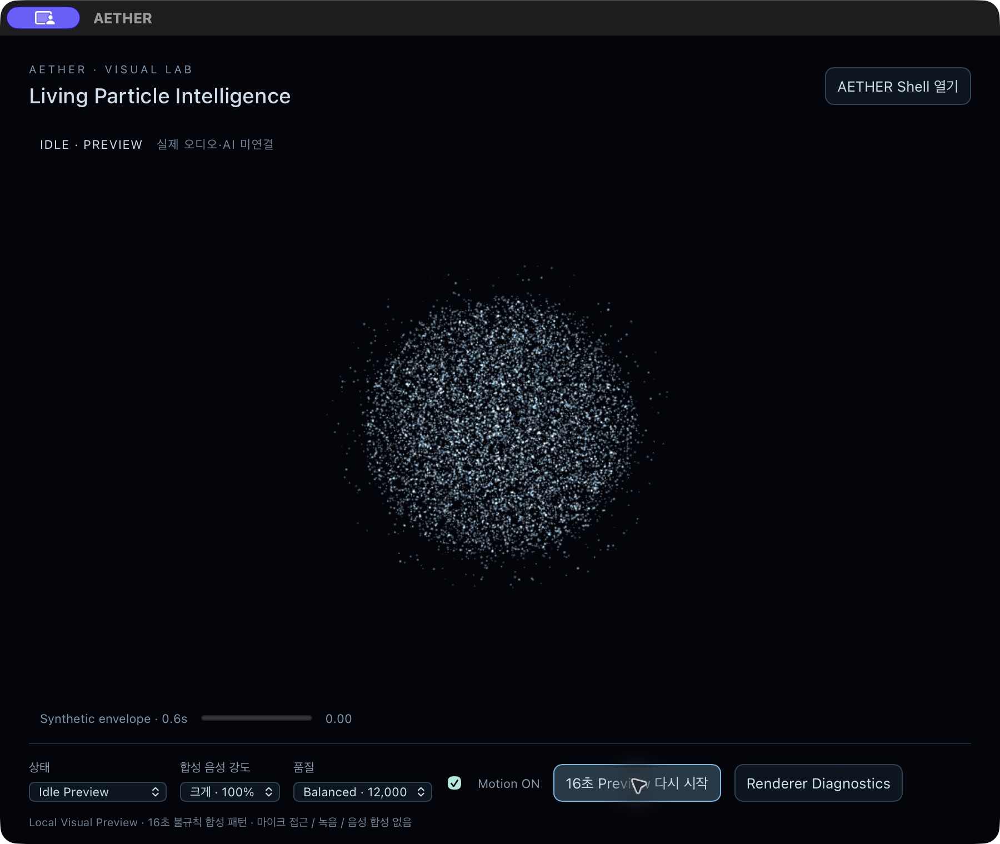
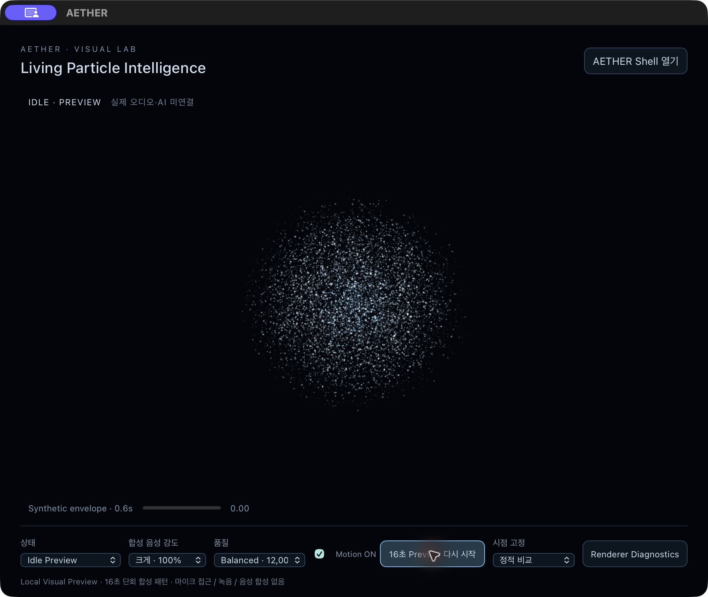
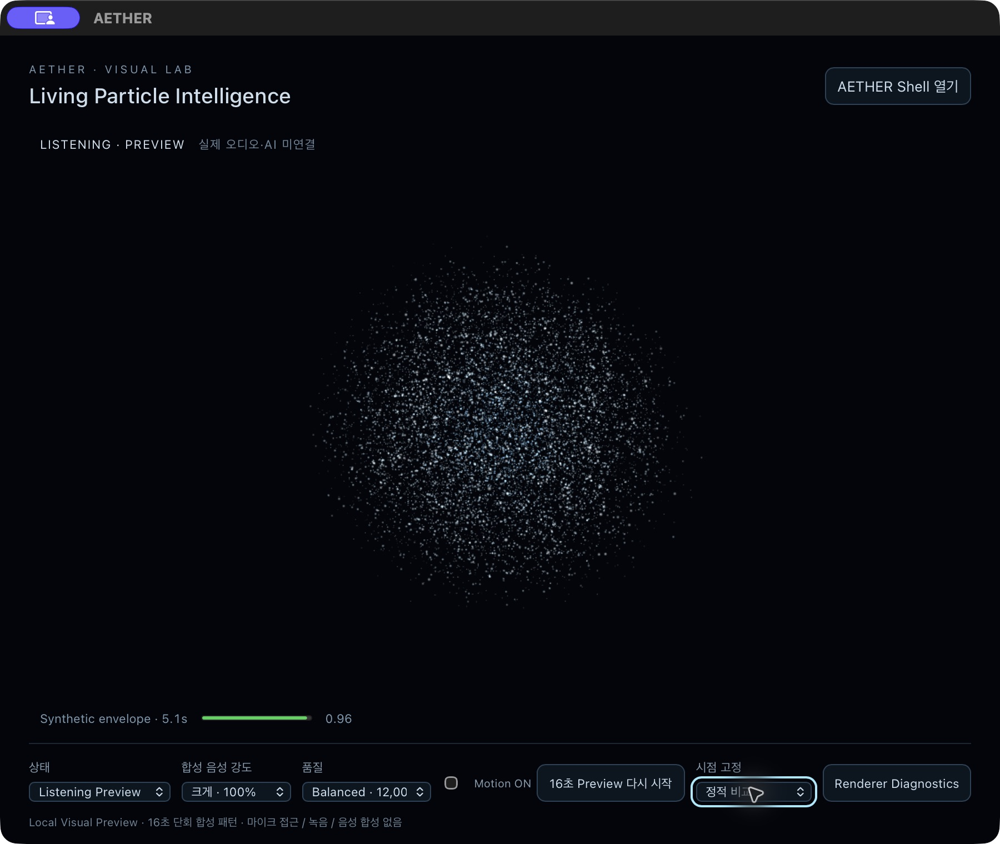
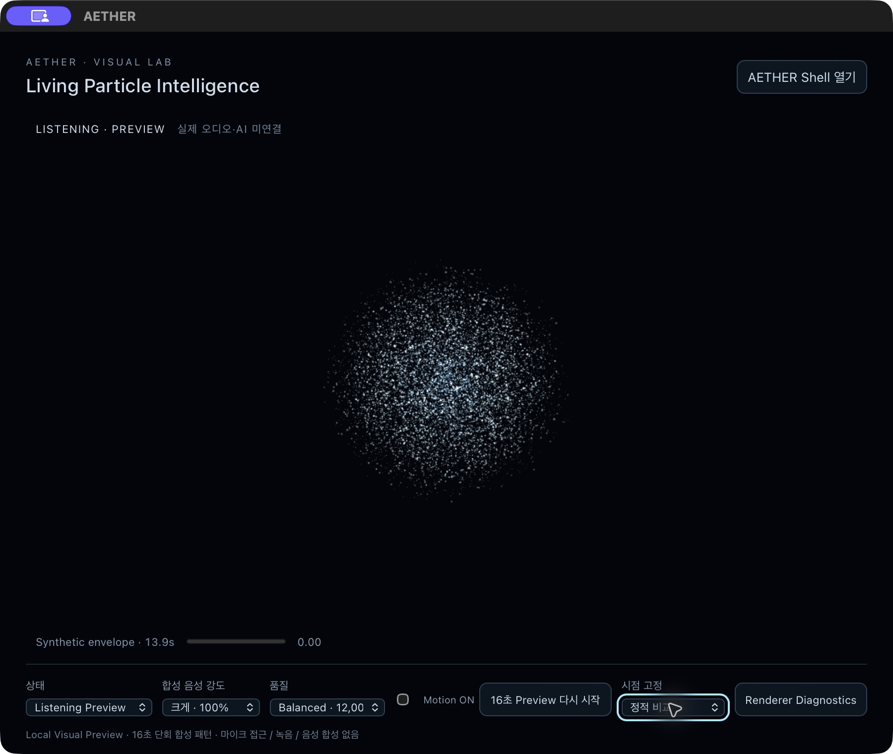
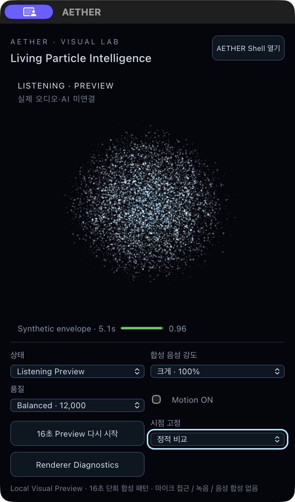
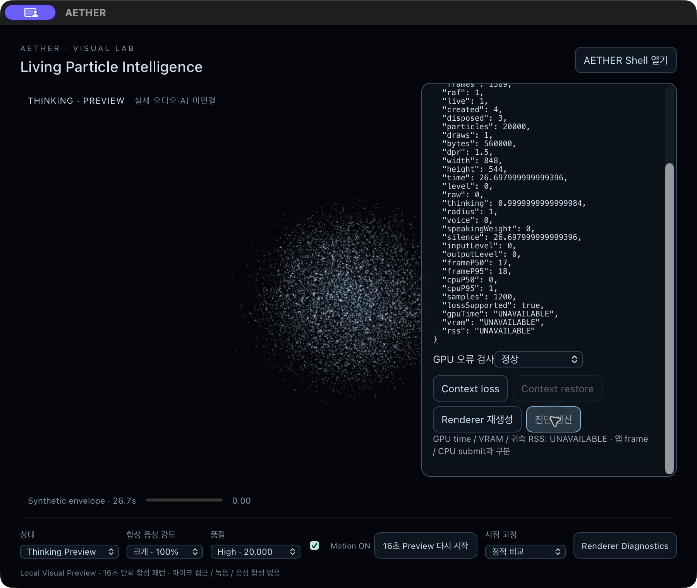

# Particle Visual Lab — 수축·확산 기준선 검증 기록

Issue #39 · 2026-11-13 · branch `feat/39-particle-visual-lab`.
기준 main `1dc502e6380918b5e7d2b15863d807e1849365e0`.

사용자는 기본 파란 입자 방향을 수용했으나 개선 Motion의 시각 승인은 아직 하지 않았다. 아래 PASS는 명시한 기능 검증에만 해당한다.

이 문서는 `455315da72c81c05ff322939369c0c5ec962364b` 기준선의 이력이다. 해당 앱은 `target/particle-lab-39/before-forward/AETHER.app`에도 같은 hash로 보존했다. 최신 전방 이동 앱의 hash·검증 범위는 [Cinematic Depth 검증](particle-depth-motion.md)을 따른다. 아래 PASS를 새 앱으로 자동 이월하지 않는다.

## 앱 식별과 재현

- 앱: worktree 기준 `target/particle-lab-39/release/bundle/macos/AETHER.app`.
- Mach-O arm64, production, `--no-sign` 로컬 검증 앱. 배포/공증 검증 아님.
- `VITE_AETHER_VISUAL_LAB=particle`, `NODE_ENV=production`, 전용 `CARGO_TARGET_DIR`, Cargo `--locked --offline`, npm `ignore_scripts=true`.
- bundle hash: `b452f23b83f372210c2d377e541003d8074c1616c04b1e58d77d2ec5aaad5e2b`.
- executable SHA256: `17f8942c8b124fd6d01c89d9e0f6542eb9091072c34fb0cecae2a583efac68a1`.
- hash 규칙: bundle 내 각 파일 SHA256의 relative-path 사전을 정렬 JSON으로 직렬화한 뒤 SHA256. 기존 benchmark의 read-only artifacts 함수를 재사용했으며 benchmark 수집은 실행하지 않았다.
- 최종 커밋 SHA는 PR에 기록한다. 로컬 `qa/final-source-inputs.json`과 HEAD 파일 내용을 비교해 검증 앱의 source 입력 동일성을 확인한다.

앱에서 상태 → 합성 음성 강도 → `16초 Preview 다시 시작` 순으로 선택한다. Listening 100%의 `시점 고정` 5.05s / 13.9s는 동일 Camera에서 확산·수축을 비교한다. Motion OFF, High 품질, Renderer Diagnostics도 직접 확인할 수 있다. 실제 마이크 입력은 없다.

## 변경 전후 실제 화면

아래는 생성형 시안이 아닌 패키징된 앱 캡처다. 변경 전 source/archive와 앱은 전용 target의 `baseline-before-refinement`에 보존했다.

| 변경 전 Idle | 개선 Idle |
| --- | --- |
|  |  |

| 5.05초 확산, Motion OFF | 13.9초 수축, Motion OFF |
| --- | --- |
|  |  |



입자 수를 늘리지 않고 크기·밝기·깊이를 계층화했다. 수축 시 입자 알파를 낮추지 않으며 공간 분포가 조밀해진다. 색상과 움직임의 최종 만족도는 사용자 검토 대상이다.

## 실제 Motion 증거

CUA가 실제 WKWebView 앱 창의 JPEG와 AX 상태를 연속 수집했다. 캡처 시간 간격을 보존하여 macOS AVFoundation으로 MP4를 만들었다. 고정 30/60fps 화면 녹화가 아니며 평균 약 7~9fps의 불균일 연속 캡처다. 프레임 보간이나 합성 렌더는 없다. 원본 프레임과 타임스탬프를 보존한다.

| 상태 | 캡처 수 | 첫/마지막 캡처 시간 차이 |
| --- | ---: | ---: |
| Listening 100% | 122 | 16.112s |
| Listening 35% | 134 | 16.161s |
| Listening 65% | 138 | 16.332s |
| Speaking 100% | 126 | 15.994s |
| Thinking | 129 | 15.879s |

각 Preview는 앱 표시상 약 16.5초까지 관찰했다. 최초 캡처 직전 짧은 구간은 포함하지 않는다. Listening/Speaking/Thinking MP4와 전체 원본 캡처는 로컬 산출물로 제공하며 저장소에는 대표 정지 캡처만 포함한다. 완전한 매 프레임 GPU 녹화: NOT_RUN.

### 화면 기반 반경 보조 지표

900×760 / 동일 Camera / 12,000개 / Listening 100%의 시점 고정 캡처를 비교했다. Retina 이미지 중앙 영역에서 `B>45, G>25, B>1.1R`인 발광 픽셀의 고정 중심 거리 90백분위를 계산했다.

- 5.05s: 249.58 image px.
- 13.9s: 181.14 image px.
- 확산/수축 비: 1.378, 약 37.8% 증가.

이는 **발광 픽셀 반경 proxy**다. 개별 입자 90백분위 좌표나 GPU transform feedback 측정이 아니다. 색상·알파·임계값·입자 크기에 영향을 받으므로 시각 승인이나 정확한 GPU 공간 측정으로 대체하지 않는다.

## 기능 검증

| 검사 | 결과 | 근거/한계 |
| --- | --- | --- |
| TypeScript / Vite production build | PASS | 최종 arm64 패키징의 frontend build, 기존 500kB chunk 경고 유지 |
| Node / lifecycle 계약 테스트 | PASS | 31개. 실제 React StrictMode/GPU를 모두 실행한 시험이 아닌 VM 계약 harness 포함 |
| Rust / pinned Node 회귀 | PASS | 19개, Runtime/IPC 소스 무변경. 정상/취소/실패/reap 계약 |
| 실제 WKWebView WebGL2 / custom shader | PASS | 실제 arm64 앱의 Points 렌더와 진단 |
| Idle/Listening/Thinking/Speaking / 세 강도 | PASS (동작) | 실제 연속 캡처. 미적 품질 PASS 아님 |
| 900×760 / 400×680 | PASS | 상태/Controls 가시성, 확산·수축 clipping 없음 |
| 1200×800 | NOT_RUN (최종 앱) | 초기 앱의 확대 시도는 907×800으로 제한되어 1200으로 오기하지 않음 |
| Motion OFF | PASS | 16.7s 동안 frames 7322, RAF 0, time 63.279 유지 |
| 시스템 reduced-motion | PASS | Motion ON에서도 frames 2193 / RAF 0 유지, 시스템 설정 OFF로 복원 |
| 숨김/복원 | PASS (앱 수준) | 약 18.9s frames 69 / RAF 0 유지, Raise 후 프레임 증가 |
| 최소화/복원 | PASS (수동 복원 보조) | 약 16.7s frames 344 / RAF 0 유지. 사용자 Dock 복원 후 frames 520 / RAF 1. 자동화 복원 문제 해결 아님 |
| context loss → restore | PASS | 자체 canvas 주입, 새 generation, old dispose. Motion OFF는 복원 뒤에도 RAF 0 |
| Shader 실패 / DOM fallback | PASS | health unavailable, live 0, RAF 0, 생성2/해제2. Shell 이동 사용 가능 |
| stale callback / StrictMode replay / 자원 해제 | PASS (계약) | 늦은 observer/restore/RAF 무효화, 최대 Renderer/RAF 1, unmount 후 자원0 |
| 기존 Shell 4화면 / AX / Dock | PASS (제한 회귀) | Navigation 후 본문 AX, 초안 유지, 기존 Neural Main 유지 |
| FakeRun A/B 완료·취소 | PASS | A succeeded/cancelled, B succeeded/reaped 및 cancelled/reaped |
| Native 승인·취소/조회 | PASS | 취소 카운터0, 승인1, macOS26, AX 권한 없음 정확 표시 |
| Reload / 정상 Quit | PASS | Lab 재진입 및 정상 종료 |
| 실제 WebKit process crash / 복원 후 재초기화 실패 | NOT_RUN | 기존 #35 유지, 계약 fallback 시험과 구분 |
| VoiceOver / 장시간 성능·전력 | NOT_RUN | AX 확인을 VoiceOver 검증으로 대체하지 않음 |
| GPU time / 실제 VRAM / 귀속 RSS | UNAVAILABLE | frame/CPU 통계와 구분 |
| 사용자 Motion 최종 시각 승인 | 대기 | 기본 방향 수용과 구분 |

## 성능 관찰

| 품질 | 입자 | draw calls | CPU attribute bytes | DPR | frame p50 / p95 | CPU submit p50 / p95 |
| --- | ---: | ---: | ---: | ---: | --- | --- |
| Balanced | 12,000 | 1 | 336,000 | 1.25 | 33 / 35ms | 0 / 1ms |
| High | 20,000 | 1 | 560,000 | 1.5 | 17 / 18ms | 0 / 1ms |

최근 1,200 샘플의 대화형 앱 관찰값이다. 캡처/상태 조작 등 부하가 존재하며 격리된 장기 benchmark가 아니다. CPU 0ms는 clock 양자화 이하일 수 있다. 목표 30/60fps의 장기 충족·전력 예산 PASS로 확대하지 않는다. P0 E5b 수치와 혼합하지 않는다.



## 보존·보안·남은 위험

#38 원래 미커밋 소스/앱/캡처, P0 #27/#34와 고정 앱/원본 데이터, #35를 변경하지 않았다. #39 독립 worktree에서만 구현했다. 설치/새 의존성/권한/IPC/CSP/Runtime 변경 없음. raw AX와 로컬 경로는 공개 저장소에 올리지 않는다.

최종 검증 앱 PID 7485, 2026-11-13 14:04:52 KST 시작, 전용 target의 실행 경로를 대조하고 정상 Quit했다. 14:17 KST 종료 후 해당 앱·build·Node child 부재를 확인했다. 다른 사용자/P0 프로세스를 종료하지 않는다.

입자 간 물리적 산란·고급 조명은 없다. Synthetic 패턴은 실제 음성 파형과 동일하지 않으며 실제 오디오/권한 연결은 후속 별도 승인 대상이다. 상태 변경 후 재시작 버튼으로 Preview를 시작한다. 정적 시점 이동과 실시간 재생의 dt가 달라 극소한 위치 차이가 가능하다. 밝기·깊이·수축의 자연스러움은 실제 사용자 리뷰를 기다린다.

```text
PARTICLE_ART_DIRECTION_ACCEPTABLE: YES
PARTICLE_DESIGN_REFINEMENT_ALLOWED: YES
CONTRACTION_EXPANSION_IMPLEMENTED: YES
PARTICLE_MOTION_VISUAL_APPROVED: NO
AETHER_MAIN_CORE_REPLACED: NO
FINAL_AETHER_VISUAL_APPROVED: NO
MAIN_MERGED: NO
NEXT_PHASE_STARTED: NO
```
