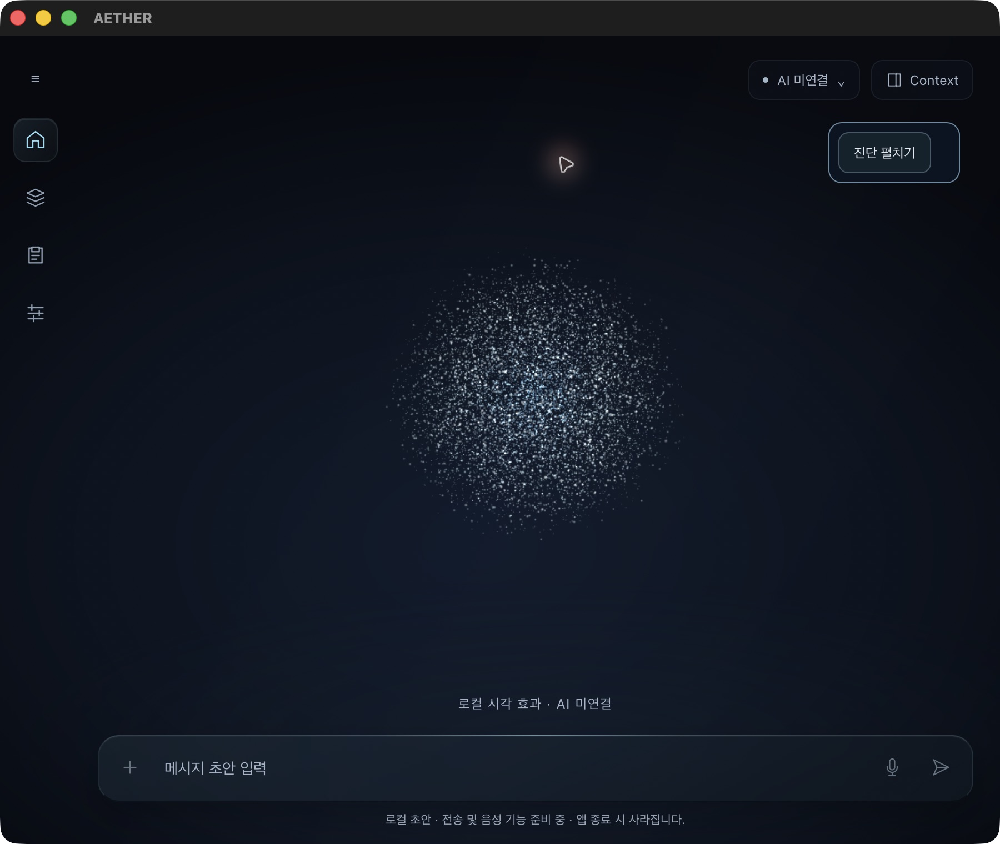
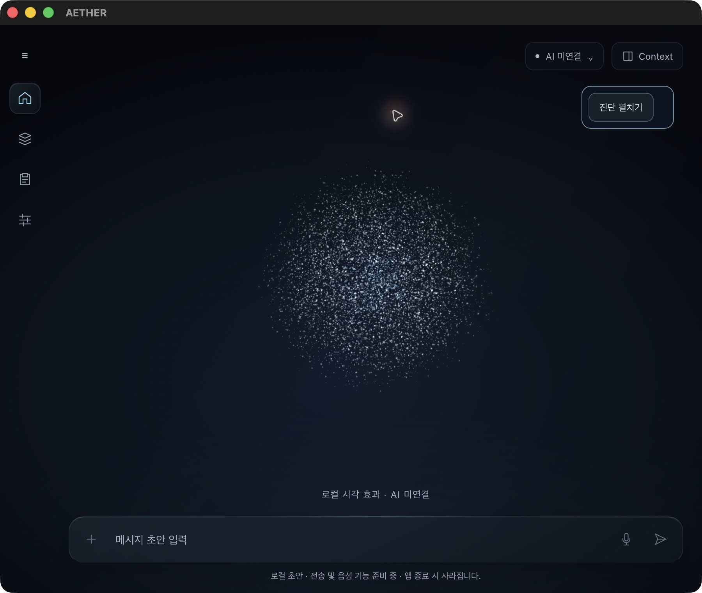
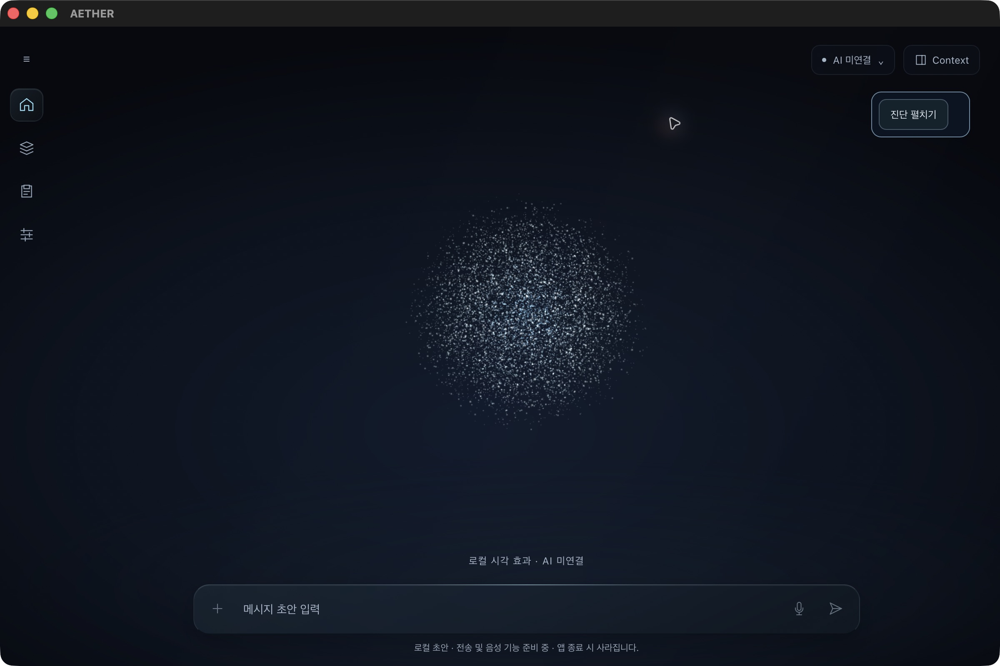
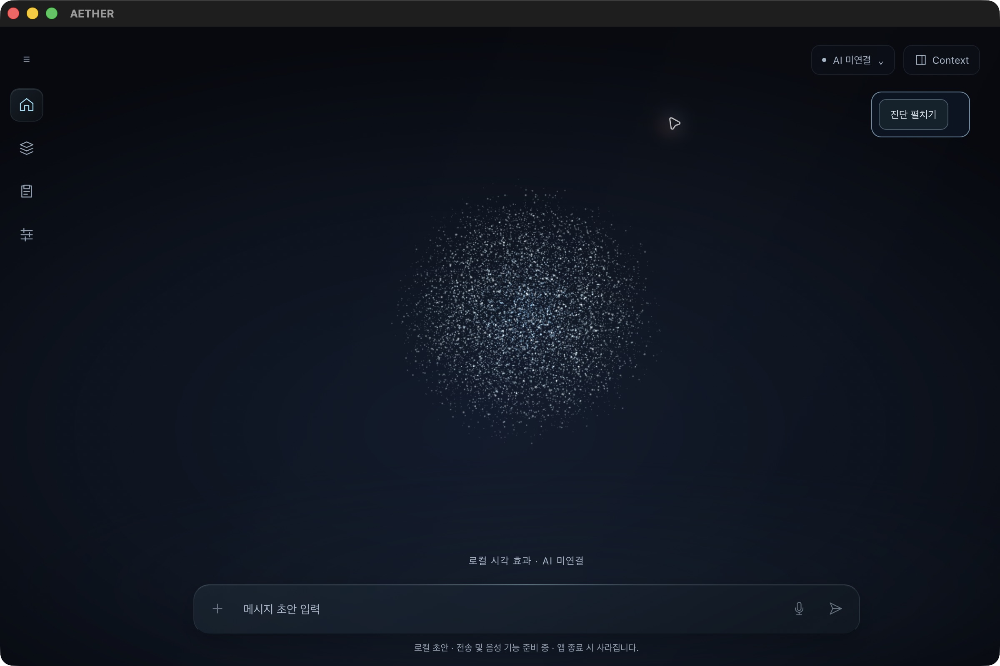
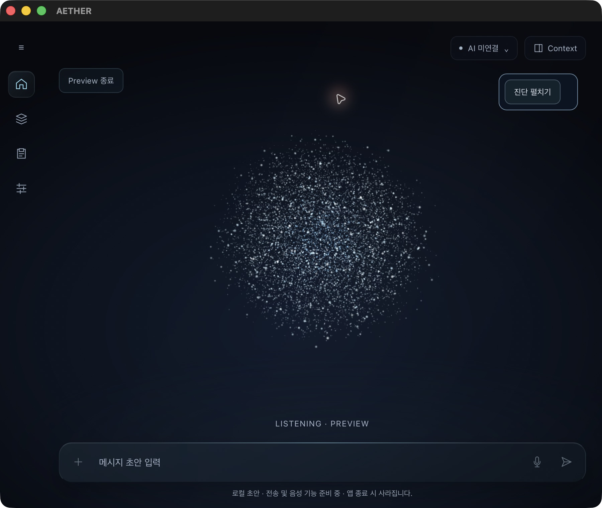
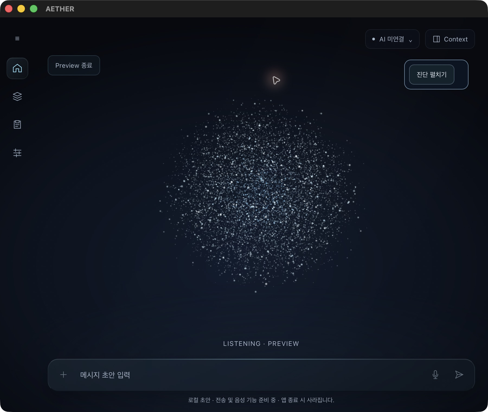
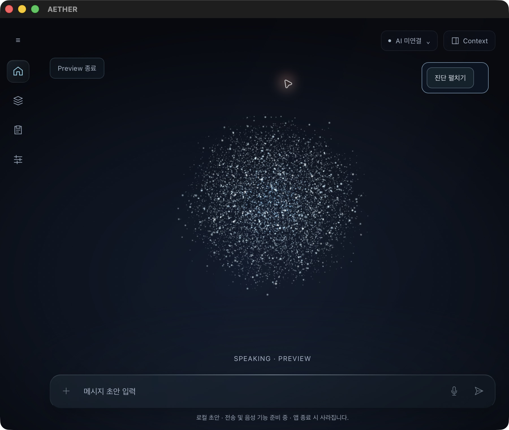
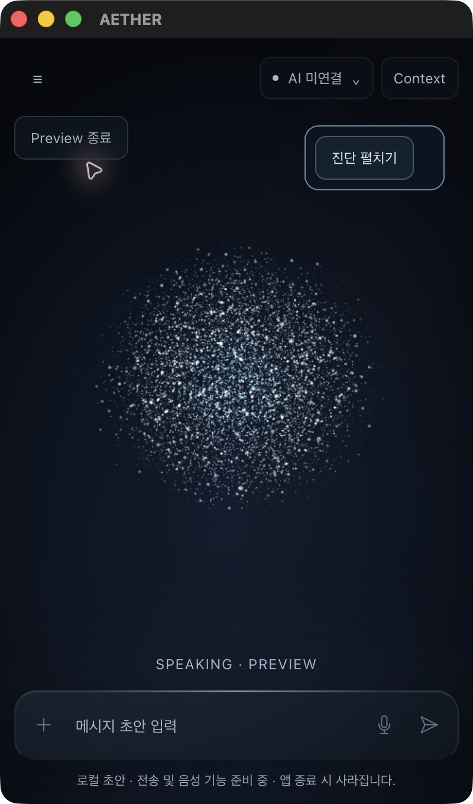
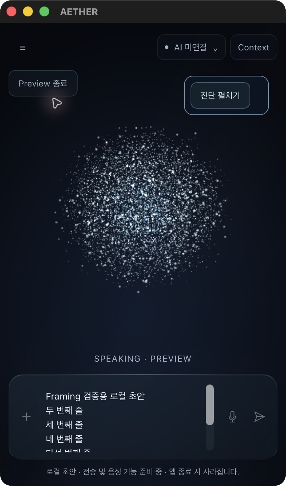
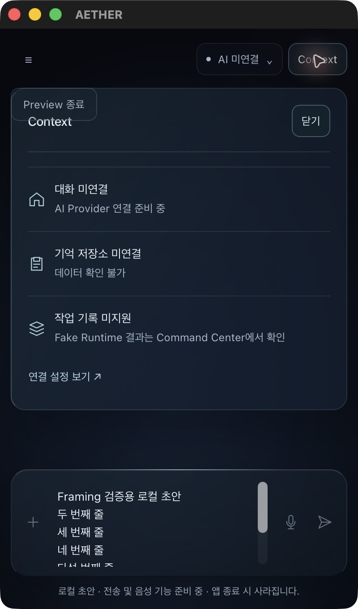

# Main Core Framing 검증 — Issue #42 / Draft PR #43

2026-11-15. base main `13cc5e3cfec511affa1642cbb43227e055954afc`, 수정 전 HEAD `87b4eacbb6a10519094c5127a49dac124f907156`, branch `feat/42-spatial-presence-main`.

이번 기록은 새 Framing 앱에 대해 실제 수행한 검사다. 이전 [Main 통합 검증](spatial-presence-main.md)은 이력으로 보존하며, 이전 PASS를 새 앱에 자동 이월하지 않는다. 최종 source HEAD와 해당 HEAD의 CI는 PR 본문에서 보고한다.

## 변경 범위와 재현성

- `main-framing.ts`: Main 전용 layout→projection zoom 함수.
- `renderer.ts`: Main resize에서만 zoom 적용, Camera/WebView 진단, 비교용 이전 Framing과 지표 초기화.
- `MainParticleHost.tsx`: Diagnostics의 동일 시점/이전 Framing/접기 조작. 일반 Main의 UI/CSS는 그대로다.
- `particle-main.test.mjs`: 모바일/Lab 유지, 연속적인 크기 변화, 비교 전후 시계·generation·입자/Motion 값 보존 계약 검사.
- 문서와 실제 앱 비교 PNG. 원본 AX/Runtime 로그, 앱 바이너리, 원시 연속 캡처는 커밋하지 않는다.

Motion envelope, attack/release, spatial radius, 전방 이동 대상·계수·복귀, particle seed/수/밝기/색/크기, point-size clamp, near-plane guard, Lab Host와 UI 색·소재 소스는 변경하지 않았다. 실제 AI/audio 값은 여전히 미연결/null이다.

새 검증 앱은 `target/spatial-framing-42/release/bundle/macos/AETHER.app`의 unsigned production arm64 bundle이다. 기존 `target/spatial-main-42/.../AETHER.app`은 보존했다.

| Manifest | SHA256 |
| --- | --- |
| 새 bundle | `80ca3f6d0a437a1949fe24240ccc601d12d09bac15adbb55dcb6f064a3d02016` |
| 새 build inputs, 57개 | `8d13ff0e3b79d0554aa821883b44bc5b086a125014bb7a2a81ee5805d8ff8efb` |
| 기존 bundle, 불변 | `533d793dbb4e7e84670819c85ec128c7de1a9ab4313f91c05adef2c229dcf1b5` |

각 manifest는 파일을 상대 경로로 정렬해 `SHA256  path\n`을 연결한 텍스트의 SHA256이다. build inputs는 이전 56개 앱 소스 목록에 `main-framing.ts`를 더한다. 패키징 후 앱 입력 변경 없이 문서/캡처만 추가했으며 최종 커밋과 목록을 대조한다. dirty build 당시의 이전 HEAD를 새 앱 source SHA로 오인하지 않는다.

## 투영 설정과 안전 영역

`zoom = 1 + 0.12 × smoothstep(480,740,width) × smoothstep(300,480,height)`.

Camera Y=0.1, look-at=(0,0,0), nominal FOV=38°, near/far=0.1/40은 유지한다. 기존 fit 거리 `2.25 / tan(min(verticalHalfFov,horizontalHalfFov))`도 유지한다. **zoom이 바뀌므로 투영 행렬은 다르다.** 폭/높이 외 입력은 없고 고정된 레이아웃에서는 16초 Preview 동안 자동 zoom하지 않는다.

| OS 창(pt) | WebView CSS px | Scene CSS px | Camera Z | 이전→개선 zoom |
| --- | --- | --- | --- | --- |
| 900×760 | 900×728 | 788×510 | 6.53447 | 1→1.12 |
| 1200×800 | 1200×768 | 1088×550 | 6.53447 | 1→1.12 |
| 400×680 | 400×648 | 376×442 | 7.68148 | 1→1 |
| 400×680, 120px Dock | 400×648 | 376×382 | 6.63875 | 1→1 |

OS 캡처는 2× 배율이다. WebView는 `window.innerWidth/innerHeight`, Scene은 실제 surface bounds를 계측했다. 기본 창 120px Dock의 Scene 788×450에는 zoom 약1.11111, Context로 좁아진 518×510에는 약1.00694를 계산한다. 작은 창의 열린 패널은 기존 정책대로 Scene을 숨기며 Dock을 독립 유지한다.

### 동일 시점 비교

아래 **전/후 모두 새 production 앱**에서 캡처했다. 이전 Framing 진단은 원래 zoom=1 투영을 재현한다. 옛 바이너리를 다시 실행한 화면이라고 주장하지 않는다. 각 쌍은 같은 Scene viewport, 방향/중심, seed3901, Balanced 12,000개, DPR1.25, gain1, Preview phase/time, UI/배경, 접힌 진단 표시를 유지한다. 시각 시계를 120Hz step으로 seek한 뒤 정지한다. 유일한 의도적 비교 변수는 projection zoom이다. 커서/원격 제어 표시는 제품 디자인이 아니다.

| 900×760 Idle t=0 이전 | 개선 |
| --- | --- |
|  |  |

| 1200×800 Idle t=0 이전 | 개선 |
| --- | --- |
|  |  |

| Listening 900×760 t=5.05 이전 | 개선 |
| --- | --- |
|  |  |

| Speaking 900×760 t=5.05 이전 | 개선 |
| --- | --- |
|  |  |

| 400×680 Speaking t=5.05 이전 | 개선(동일 zoom) |
| --- | --- |
|  |  |

| 최소 창 최대 Dock | Context + 최대 Dock |
| --- | --- |
|  |  |

로컬 리뷰 갤러리에 Listening/Speaking t=13.9 긴 쉼, 넓은 창 강한 반응, 최소 창 약한 반응, 기본 창 최대 Dock/Context/Status/펼친 Navigation도 포함한다. `speaking-400-t2_95`라는 초기 캡처는 AX 실제 time=1.1로 밝혀져 중간 반응 증거에서 제외했다. 중간 반응은 연속 시퀀스에 포함되지만 정확한 t=2.95 정적 비교는 NOT_RUN이다.

## 실제 앱과 회귀 검사

| 항목 | 결과와 범위 |
| --- | --- |
| TypeScript / production build / arm64 packaging | PASS. JS802.37KB, gzip217.31KB. 기존 500KB chunk 경고 유지 |
| Node 전체 | PASS 40/40. 실제 Host/Renderer를 doubles로 실행한 계약 테스트 포함. 실제 GPU 시험과 구별 |
| Rust | PASS 19/19, 이번 전용 target에서 locked/offline 실행. 실제 pinned Node roundtrip/cancel/reap 검사 포함 |
| 세 창 크기 / 60·120px Dock | PASS 관찰. 캡처에서 Dock·상태 조작 영역 잘림 없음 |
| 패널 / 펼친 Navigation / resize | PASS 관찰. 가용 Scene 변화에 따라 fit/zoom 재계산, 작은 창 패널의 Scene 숨김 유지. 모든 중간 픽셀의 무간섭을 증명한 것은 아님 |
| 네 화면 / AX | PASS: 페이지 본문 확인, Main↔Memory 5회 추가 왕복, created24/disposed23/live1. 20회 stale/cleanup은 계약 테스트이며 새 앱의 20회 GUI로 표기하지 않음 |
| 입력 / Escape | PASS: 복원 후 로컬 초안 입력·삭제, Context Esc 닫기. 전체 VoiceOver/모든 Focus 순서 검사는 NOT_RUN |
| Motion OFF | PASS frames3/RAF0. ON 재개 |
| 실제 시스템 reduced-motion | PASS. 초기 도구 복원은 비활성 정지와 섞여 근거에서 제외. Native dialog 취소 뒤 활성 상태에서 `Motion 정적 · 단발 렌더`, frames3/RAF0 반복 관찰. 시스템 설정 원래 OFF 복원 뒤 frames66/RAF1 |
| 숨김 / 복원 | PASS frames18/RAF0 유지, 복원 frames265/RAF1 |
| 최소화 / 복원 | PASS frames274/RAF0 유지. 도구만으로는 활성화가 되지 않아 사용자 Dock 활성화 지원 후 frames392/RAF1 및 `복원 입력 확인` 입력. 자동화 복원 문제 해결을 주장하지 않음 |
| Context loss / restore | PASS 자체 canvas lost/fallback/RAF0, 복원 ready/live1/created30/disposed29/RAF1 |
| Native / Runtime | PASS: A/B succeeded, B exit0/reaped, A25% 취소, macOS26/AX권한 조회, Native 취소·승인 후 카운터1. Runtime/IPC 소유권 변경 없음 |
| Quit | PASS 직접 실행 앱 정상 Quit, 해당 PID·실행 경로 잔존 없음 |
| Governance / whitespace | 최종 커밋 전 PASS. CI는 Governance 전용이며 앱 테스트 실행을 뜻하지 않음 |

이번 앱에서 GUI Reload, Shader 실패 재주입, 전체 기존 Runtime 오류 매트릭스는 NOT_RUN이다. Node/Rust 계약 회귀와 앞선 앱 이력을 구별한다. #35의 실제 복원 뒤 재초기화 실패, 실제 WebKit process crash, 장시간 전력/배터리/VoiceOver는 NOT_RUN을 유지한다. 공유 WebKit 프로세스를 종료하지 않았다.

저장소 루트에서 실행한 주요 명령:

```sh
npm --prefix apps/desktop run typecheck
node --experimental-vm-modules --test apps/desktop/tests/*.test.mjs
CARGO_TARGET_DIR="$PWD/target/spatial-framing-42" CARGO_NET_OFFLINE=true \
  cargo test --manifest-path apps/desktop/src-tauri/Cargo.toml --locked --offline
CARGO_TARGET_DIR="$PWD/target/spatial-framing-42" CARGO_NET_OFFLINE=true npm_config_ignore_scripts=true \
  npm --prefix apps/desktop run tauri -- build --bundles app --no-sign -- --locked --offline
python3 scripts/validate_governance.py
git diff --check
```

기존 Cargo PATH 및 설치된 의존성을 사용했다. 설치나 dependency lifecycle hook 실행은 하지 않았다.

## 연속 Motion 기록

실제 앱 screenshot을 연속 수집하고 세 번 중 한 번을 PNG로 저장해 timestamp 기반 H.264 영상으로 재구성했다. 보간/생성형 프레임 없음. 아래는 캡처 빈도이며 Renderer FPS가 아니다. 시작 버튼 클릭과 AX 확인 직후부터 기록하므로 시작 직후 짧은 구간 및 저장 프레임 사이 움직임은 미수집이다.

| Preview / 창 | 저장 프레임 | 수집 범위(ms) | 평균 캡처 fps | 최대 간격(ms) |
| --- | ---: | --- | ---: | ---: |
| Listening 900 | 153 | 42–20019 | 7.61 | 329 |
| Speaking 900 | 156 | 38–19920 | 7.80 | 191 |
| Listening 400 | 176 | 52–19963 | 8.79 | 146 |
| Speaking 400 | 173 | 45–19957 | 8.64 | 253 |
| Listening 1200 | 145 | 51–20027 | 7.21 | 215 |
| Speaking 1200 | 142 | 46–19927 | 7.09 | 218 |

여섯 시퀀스 끝의 AX에서 Preview 종료/AI 미연결 idle 복귀를 확인했다. Listening900 첫 시도는 비활성 정지로 종료에 도달하지 못했으므로 제외하고 재기록했다. 영상은 새 Framing의 연속 검증이며, 이전 앱 영상과 같은 visual clock의 동기 비교라고 주장하지 않는다. 정적 전후 쌍과 연속 동작 검증을 분리한다. Motion 자연스러움의 최종 판단은 사용자 리뷰다.

## 비용과 화면 경계

동일 900×760/Scene788×510, Balanced, seed3901, idle, DPR1.25, 진단 overlay 표시 상태에서 약16초씩 비교했다. 완전히 같은 samples 수/측정 종료 시점은 아니며 짧은 관찰이다. 캡처 도구 부하가 포함된다. P0 Runtime 벤치마크와 혼합하지 않는다.

| 설정 | 입자 / draw / attribute bytes | frame interval p50/p95 | CPU submit p50/p95 | samples / visual time |
| --- | --- | --- | --- | --- |
| 이전 zoom1 | 12000 / 1 / 336000 | 33/35ms | 0/1ms | 488 / 16.266s |
| 개선 zoom1.12 | 12000 / 1 / 336000 | 33/36ms | 0/1ms | 492 / 16.401s |

0ms는 timer 양자화이며 비용0이 아니다. GPU time·VRAM·WebKit 귀속 RSS는 UNAVAILABLE이다. 확대된 투영은 fragment coverage를 늘릴 수 있으므로 GPU 비용 동일성이나 장시간 30fps 보장을 주장하지 않는다.

추가 CPU reference audit는 실제 변경하지 않은 particle/depth/motion 공식을 12,000개 입자, 0–16초 0.1초 간격 및5.05초, idle/listening/speaking, 전후5개 viewport에 적용했다. 최대 absNDC0.72005, 최소 view depth2.64134, near-guard 축소0, point-size clamp 수는 전후 동일했다. 이 값은 **GPU 좌표 readback이 아닌 모델 결과**다. 중간 GPU 프레임 전체나 renderer rasterization을 검증했다고 확대하지 않는다. 대표 실제 캡처에서 갑작스러운 잘림은 관찰하지 않았다.

## 보존·종료·승인

기존 bundle hash와 particle/motion/depth/UI CSS hash 불변. 다른 worktree의 HEAD/status를 시작/종료 대조했다: P0 E5b clean, #38 두 worktree 미커밋 상태 그대로. P0 고정 앱/원시 자료, #35, 기존 캡처를 읽기 보존했으며 수정/정리하지 않았다. 앱 PID23431, 시작2026-11-15 14:39:32, 이번 전용 bundle의 실행 경로를 대조해 정상 Quit했다. 사용자 앱·P0 프로세스는 종료하지 않았다. Rust 테스트·영상 인코더도 exit0으로 종료했고 최종 읽기 전용 process 검사에서 P1 앱/빌드/테스트/인코더 및 P0 수집기 후보가 없었다. 프로세스 정리 PASS이며 이후 빌드·GUI를 중지한다.

의존성 설치·lockfile·Rust/Swift/Node/IPC/CSP/권한 변경 없음. 비식별 앱 이미지와 설명만 공개하며 AX/Runtime 로그는 로컬에 둔다. Ready/merge 또는 실제 audio 통합을 하지 않는다.

Framing 자체로 중심 비중은 증가했다. 이번 증거만으로 Motion 강화가 필요하다고 단정하지 않는다. 사용자가 비교 뒤 여전히 부족하다고 판단할 때만 Listening/Speaking 강한 구간의 제한적 전방 반응을 별도 검토한다.

```text
MAIN_FRAMING_REFINEMENT_ALLOWED: YES
PARTICLE_DESIGN_CHANGE_ALLOWED: NO
PARTICLE_MOTION_TUNING_ALLOWED: NO
VISUAL_LAB_BASELINE_PRESERVED: YES (소스/계약; 새 Lab GUI 비교 NOT_RUN)
MAIN_FRAMING_VISUAL_APPROVED: NO
MAIN_IMPLEMENTATION_VISUAL_APPROVED: NO
REAL_AUDIO_INTEGRATION_ALLOWED: NO
MAIN_MERGED: NO
```
