# Spatial Presence Main 검증 — Issue #42

2026-11-15 · 기준 main `13cc5e3cfec511affa1642cbb43227e055954afc` · `feat/42-spatial-presence-main`.
디자인 기준은 #41, Particle 기준은 PR #40이다. 실제 구현 시각 승인과 최신 HEAD 병합 승인은 아직 없다.

## 앱과 재현성

- P1 전용 `target/spatial-main-42/release/bundle/macos/AETHER.app`, Mach-O arm64, unsigned production bundle.
- 검증 앱은 마지막 source 변경 이후 패키징했다. 이후 문서·증거 추가만 수행하며, 커밋 후 앱 입력 manifest의 일치 여부를 별도로 확인한다. 빌드 당시 base SHA만을 앱 source SHA라고 주장하지 않는다.
- Bundle manifest SHA256: `533d793dbb4e7e84670819c85ec128c7de1a9ab4313f91c05adef2c229dcf1b5`.
- Build-input manifest SHA256: `20f1e07b1dc0e964b532b03f272ba760527236526e7617c1f25ddbd1ab0898c0`.
- Bundle hash는 모든 bundle 파일을 상대 경로로 정렬하고 각 파일의 `SHA256  relative-path\n`을 연결한 manifest의 SHA256이다. Build-input manifest는 `apps/desktop`의 tracked/untracked 소스 56개(테스트 제외)를 같은 방식으로 기록한다. 의존성 버전/lockfile 변경 없음.
- 원본 캡처, AX 관찰, timestamp JSON, MP4, manifest는 로컬 `spatial-main-42/final` 산출물로 보존한다. 개인정보나 Runtime instance가 포함될 수 있는 원본 로그는 공개 저장소에 올리지 않는다.

## 실행한 검사

| 검사 | 결과 및 경계 |
| --- | --- |
| `npm --prefix apps/desktop run typecheck` | PASS |
| Node 전체 `node --experimental-vm-modules --test apps/desktop/tests/*.test.mjs` | PASS 39/39, 이후 진단 표시 수정에 대한 Main 계약 테스트 5/5 재확인 |
| `cargo test --manifest-path apps/desktop/src-tauri/Cargo.toml --locked --offline` | PASS 19/19 |
| arm64 production packaging | PASS, TypeScript/Vite/sidecar 포함. JS 약 800.59KB / gzip 216.82KB, 500KB chunk 경고는 남음 |
| `python3 scripts/validate_governance.py` / `git diff --check` | PASS, 최종 커밋 전 재확인 |
| GitHub Governance CI | PR의 정확한 HEAD별 실행으로 별도 보고. CI가 TS/Rust/Node/GUI를 수행했다는 의미 아님 |

패키징은 기존 Cargo/Node 환경을 사용했으며 설치나 dependency lifecycle hook 실행은 하지 않았다.

```sh
PATH="$HOME/.cargo/bin:$PATH" \
CARGO_TARGET_DIR="$PWD/target/spatial-main-42" \
CARGO_NET_OFFLINE=true npm_config_ignore_scripts=true \
npm --prefix apps/desktop run tauri -- build --bundles app --no-sign -- --locked --offline
```

새 Main Host 계약 테스트는 production Host/adapter를 DOM·React·GPU doubles에서 실행한다. StrictMode replay, 늦은 observer/restore/RAF, 20회 소유권 교체, actual/preview/session/epoch/sequence/audio 거부, 투명 합성 설정, 실패 복원 시 fallback/no retry를 검사한다. 실제 WKWebView 시험과 구별한다.

## 실제 WKWebView 검증

| 항목 | 결과 |
| --- | --- |
| 900×760 / 400×680 / 1200×800 | PASS: 실제 창 캡처 1800×1520 / 800×1360 / 2400×1600, 2× scale. 이는 OS 창 크기이며 canvas 크기가 아님 |
| WebView와 Scene | 기본 창의 측정된 Scene 788×510, 최소 창 Scene 376×442. Native chrome 약 32pt를 뺀 콘텐츠는 900×728 / 400×648 / 1200×768로 화면에서 산정한 값이며 `innerHeight` 계측값은 아님 |
| 네 화면 / Navigation | PASS: 펼침·접힘, 작은 창 메뉴, 화면 전환 후 AX 본문/제목, 키보드 이동·Focus |
| Context / Status | PASS: 기본 닫힘, Esc·닫기·실행 버튼 Focus 복귀, 미연결 문구, 작은 창 Dock 독립. 작은 창 열린 패널에서는 Scene 숨김/RAF 0 |
| Dock | PASS: 기본 60px·최대 120px, 여러 줄/내부 스크롤/삭제 후 축소, Navigation 왕복 초안 유지, 비활성 버튼 이름·사유 |
| 한글 IME | PASS — 사용자 직접 조합·줄바꿈·삭제 확인. 자동 도구는 붙여넣기만 확인했으며 IME 자체를 자동 검증했다고 하지 않음 |
| 실제 투명 합성 | PASS 관찰: canvas 검은 사각형/외곽 검은 테두리 없이 남청색 DOM 배경에 합성. 밝기·크기 계층 유지. 이전 Lab과 픽셀 동일성은 주장하지 않음 |
| Preview | PASS: 명시적 Idle/Listening/Thinking/Speaking, 실제 AI 미연결 표시, 16초 패턴 후 idle 복귀 및 수동 해제. 실제 audio 값 null |
| Main ↔ Memory 20회 | PASS: AX 본문 확인, 종료 시 live 1 / created 22 / disposed 21 / RAF 1 |
| Motion OFF / 시스템 reduced-motion | PASS: 정적 frames 1 / RAF 0. 실제 OS 설정 ON으로 확인 후 원래 OFF로 복원 |
| 숨김 | PASS: frames 270 / RAF 0 유지, 복원 후 frames 280 / RAF 1 |
| 최소화 | PASS: frames 416 / RAF 0 유지, 사용자의 Dock 복원 후 frames 450 / RAF 1 및 입력 확인. 도구만으로 활성화 복원이 되지 않은 한계는 남음 |
| Context loss / restore | PASS: 자체 canvas 주입, lost/fallback 및 RAF 0, 복원 후 generation 교체/live 1/frames 증가. 공유 WebKit 프로세스 종료 없음 |
| Shader compile 실패 | PASS: 실제 fault 선택 후 DOM fallback, 탐색·로컬 초안 유지, 정상 옵션 복구 |
| Native / Runtime | PASS: macOS 버전/Accessibility 조회, 코어 점등, 승인 취소 0·승인 1, A/B 완료·25% 취소, Node reaped. A 실행 중 Navigation 후 완료 유지 |
| Reload | PASS: A는 기존 정책대로 failed, B는 reload 후 running 유지하고 취소. Native 승인 카운터 유지 |
| Quit | PASS: 직접 실행한 앱 정상 Quit, PID·시작 시각·정확한 실행 경로로 종료 대조 |

최소화/숨김 PASS는 앱 수준 지속 RAF 정지 근거다. GPU 전체 정지·소비 전력 PASS로 확대하지 않는다. GPU 실패 중 Runtime 소유권은 변경하지 않았으며 실제 복원 재초기화 실패의 종합 앱 검사는 #35 NOT_RUN을 유지한다.

## 실제 화면과 디자인 기준 비교

왼쪽은 승인된 디자인 **목업**, 오른쪽은 실제 패키징 앱이다. 목업은 구현 증거가 아니다. Native titlebar, 실제 disabled 조작, 로컬 초안·미연결 안내를 유지했다. 캡처의 보라색 원격 제어 표시와 커서는 앱 디자인이 아니다.

| 디자인 기준 목업 900×760 | 실제 앱 900×760 |
| --- | --- |
| 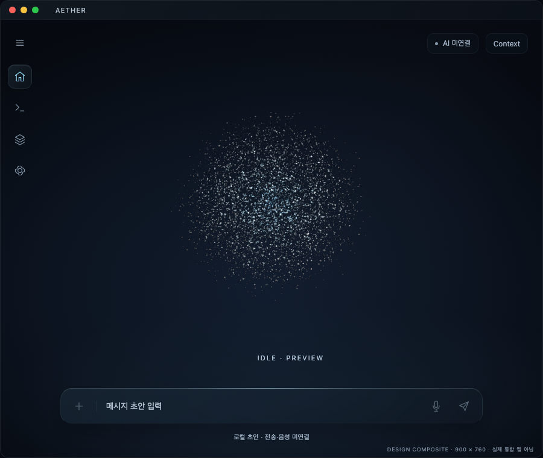 | 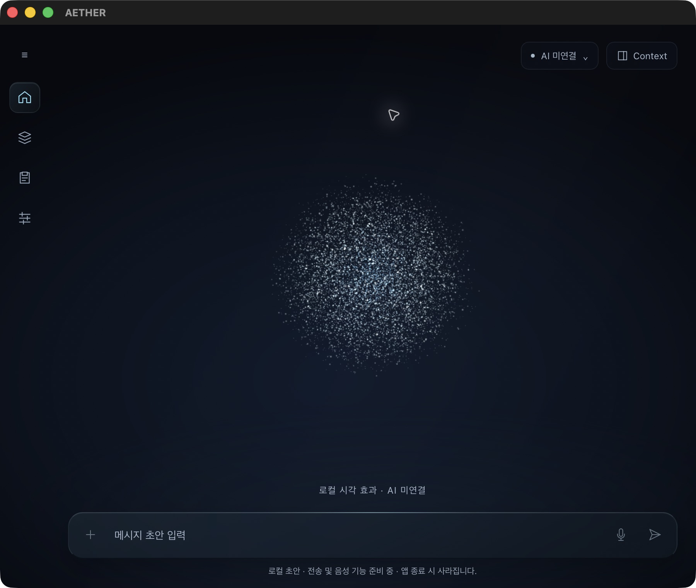 |

| 최소 창 실제 앱 | 넓은 창 실제 앱 |
| --- | --- |
| 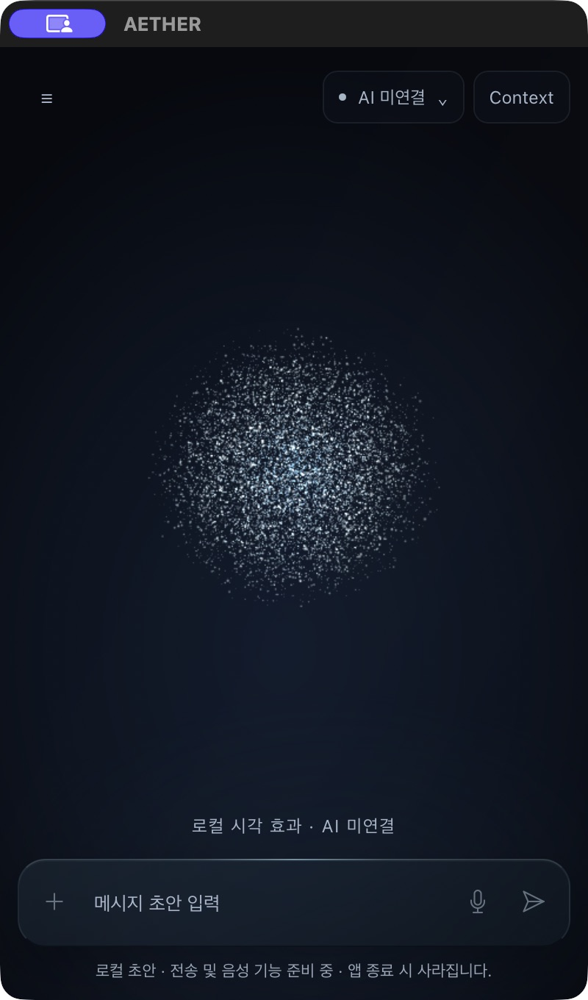 | 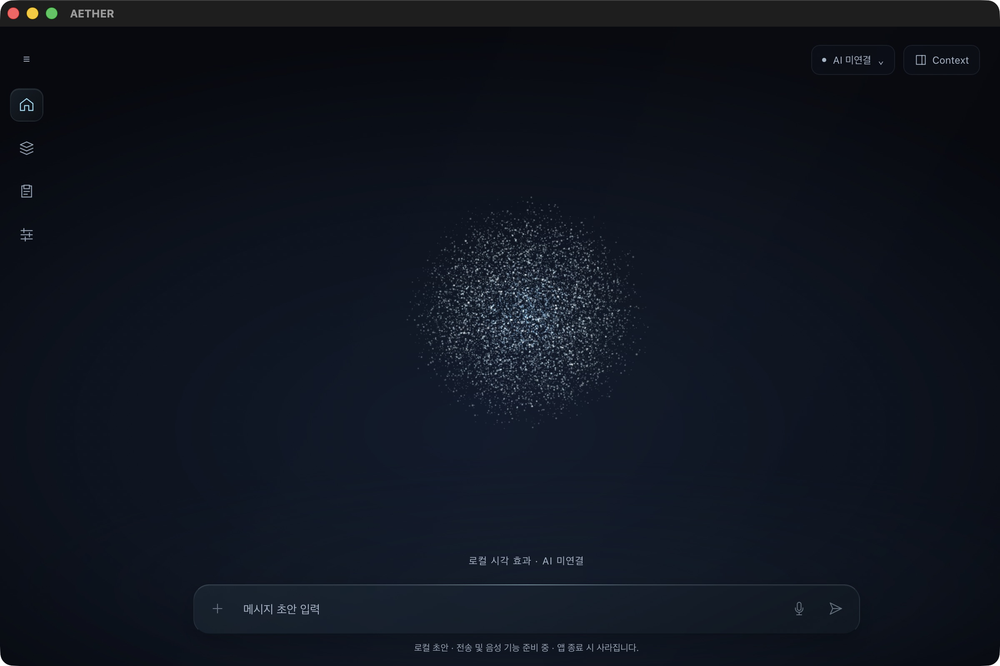 |

| Memory | Settings |
| --- | --- |
| 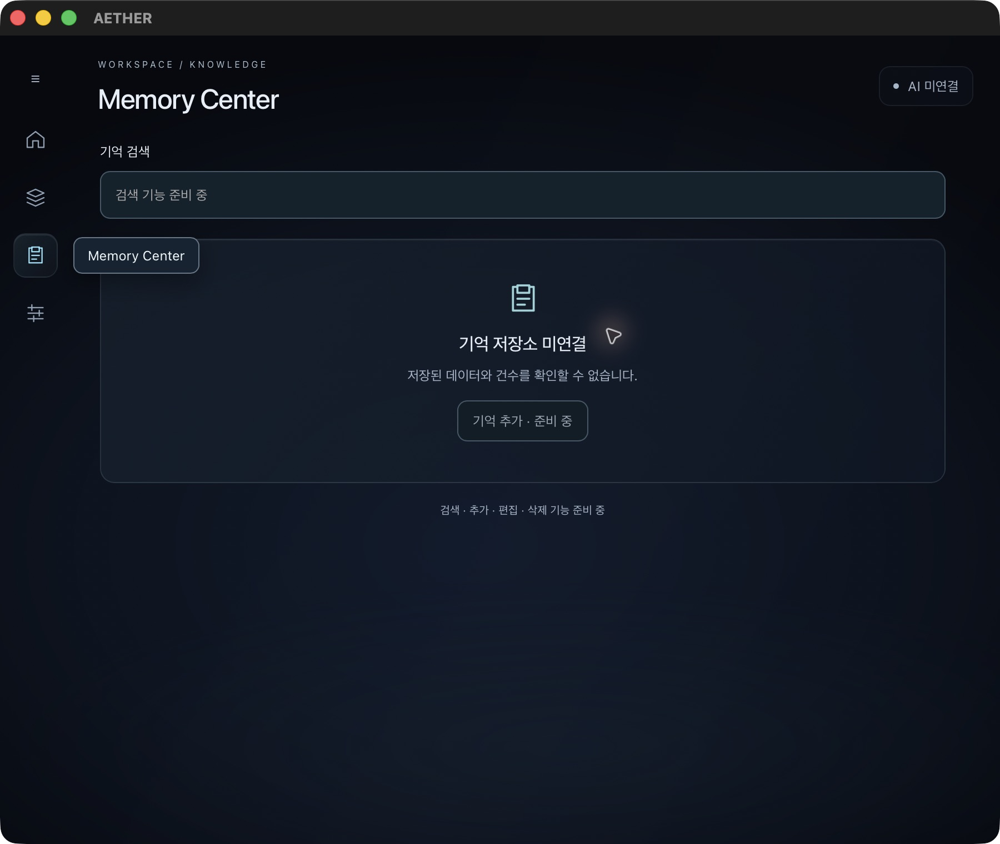 | 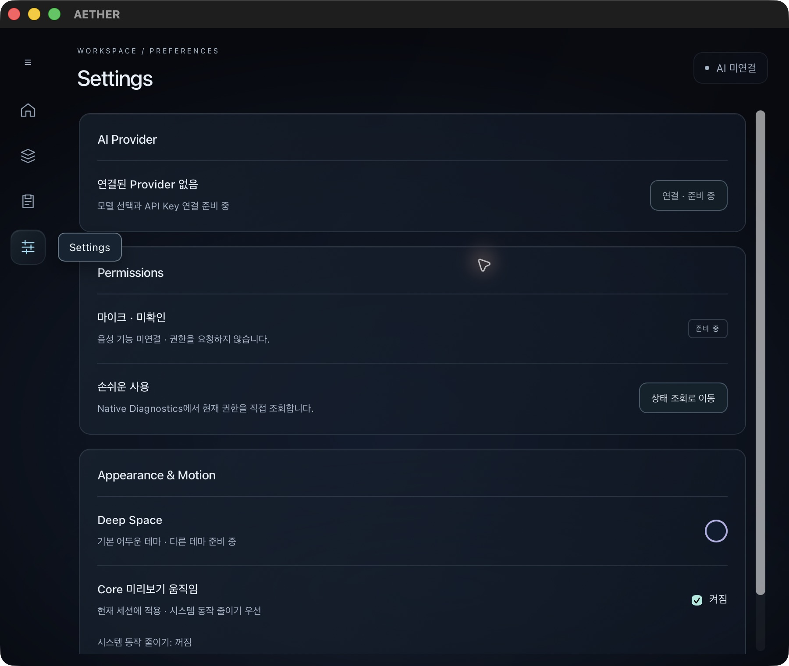 |

| Context 최소 창 | Context 넓은 창 | 최대 Dock |
| --- | --- | --- |
| 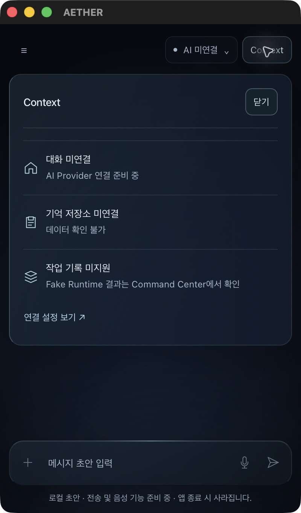 | 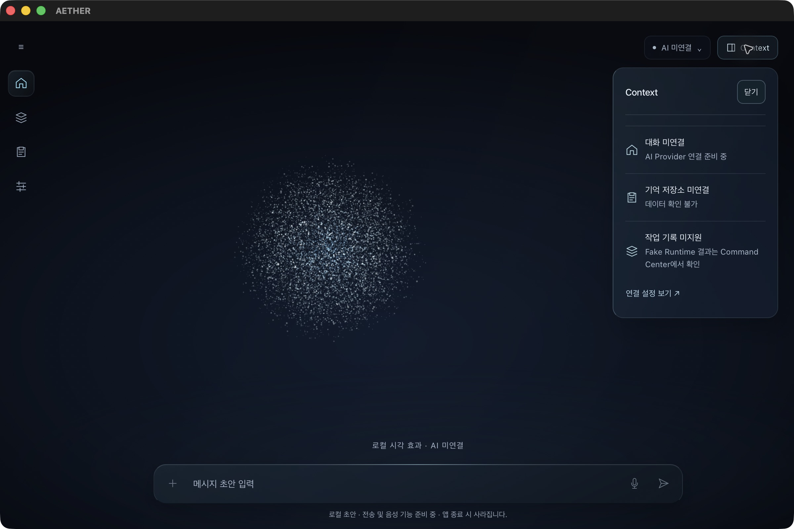 | 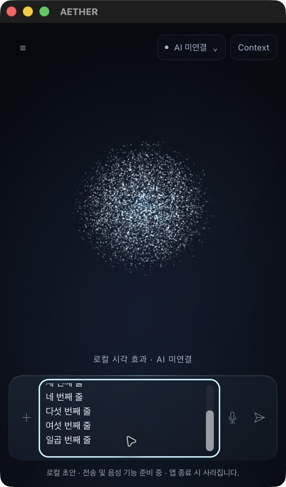 |

| Speaking 확산 기본 | 최소 | 넓음 |
| --- | --- | --- |
| 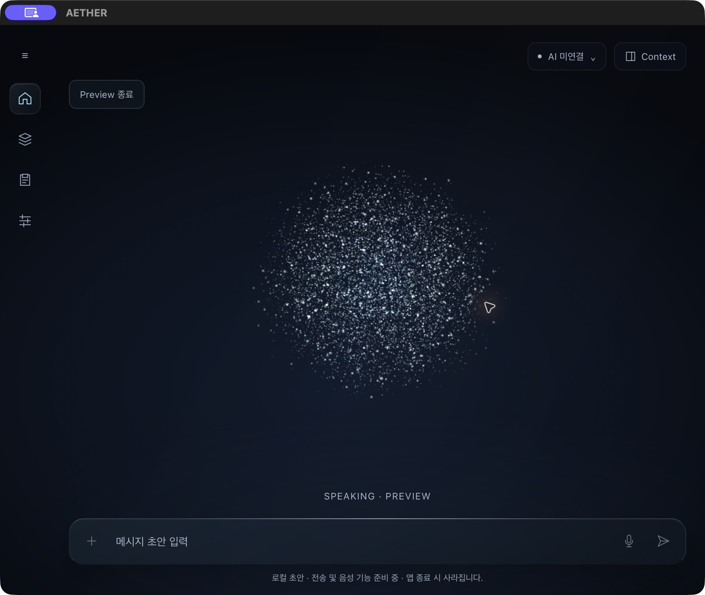 | 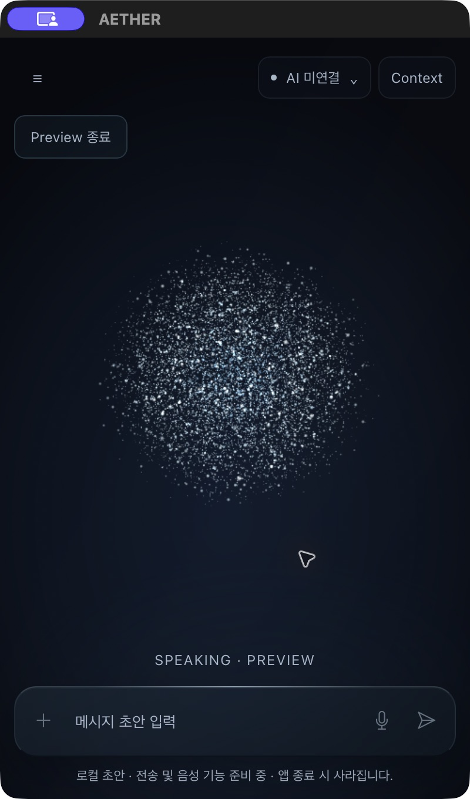 | 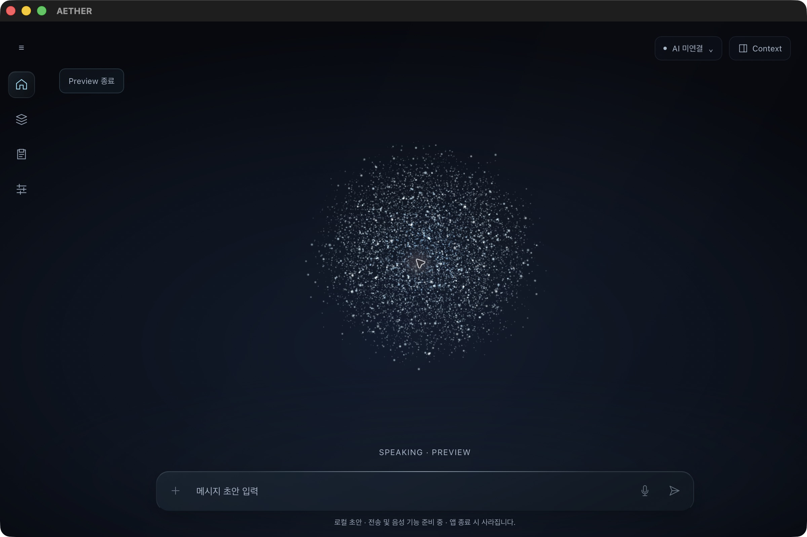 |

위 확산 이미지는 기록 시작 약 5초의 실제 프레임이다. 정확한 simulation seek 5.05초 동일 비교라고 주장하지 않는다. 별도의 전체 연속 캡처로 패턴 및 복귀도 관찰했다.

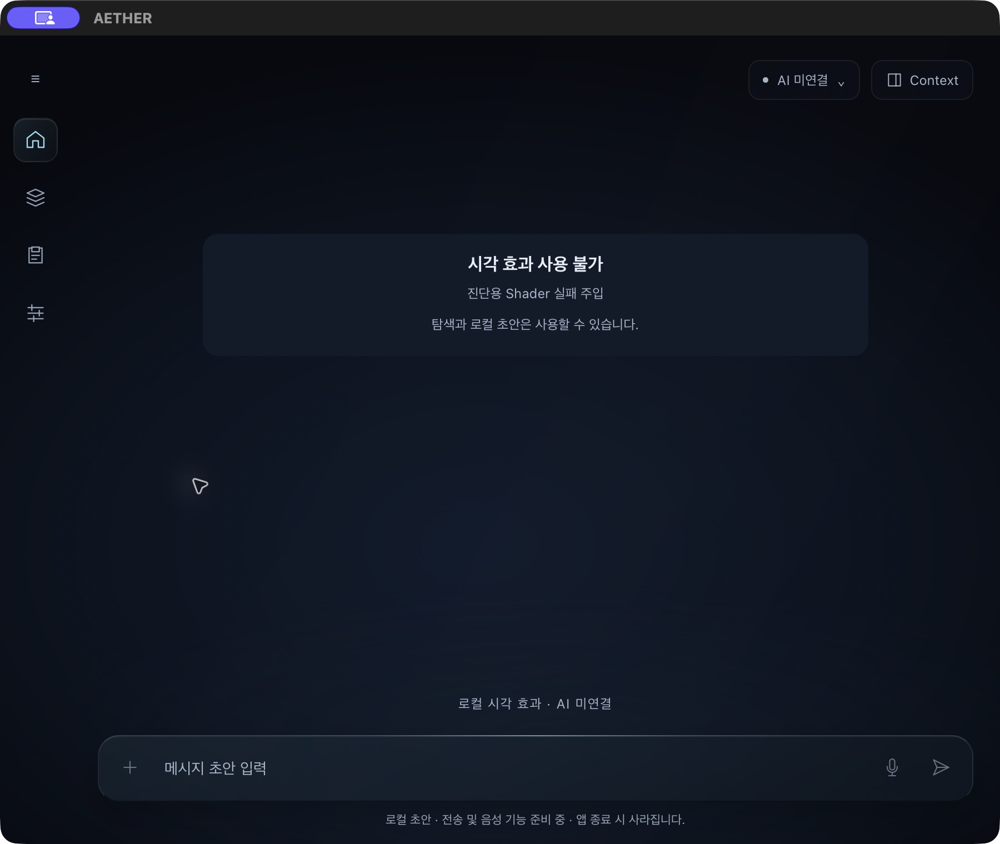

## 연속 기록의 방식과 한계

GUI 도구의 실제 앱 screenshot을 연속 수집하고 세 번 중 한 번을 PNG로 보존했다. 저장 timestamp로 AVFoundation H.264 영상을 재구성했다. 프레임 보간·생성형 영상·목업 혼합 없음. 아래 값은 **캡처 빈도**이며 Renderer fps가 아니다.

| 모드 / OS 창 | 프레임 | 저장 시간 범위(ms) | 평균 캡처 fps | 최대 간격(ms) |
| --- | ---: | --- | ---: | ---: |
| Listening 900×760 | 130 | 72–19928 | 6.50 | 828 |
| Speaking 900×760 | 150 | 72–19947 | 7.50 | 521 |
| Listening 400×680 | 150 | 71–19987 | 7.48 | 944 |
| Speaking 400×680 | 150 | 71–19979 | 7.48 | 811 |
| Listening 1200×800 | 145 | 75–19891 | 7.27 | 528 |
| Speaking 1200×800 | 141 | 71–19999 | 7.03 | 547 |

처음 약 71–75ms와 프레임 사이 움직임은 미수집이다. 각 시퀀스 끝에서 Preview 종료/로컬 미연결 복귀를 AX로 확인했다. 관찰된 프레임에서는 Dock/Navigation 침범이 보이지 않지만 모든 GPU frame의 비침범을 증명하는 자료는 아니다. 넓은 창 최초 시도는 GUI 연결 중단 뒤 비활성 상태로 정지한 동일 이미지였으므로 제외하고 활성 복원 후 다시 기록했다.

## 성능과 보류 항목

기본 창 Scene 788×510, seed 3901, idle, 개발 진단 overlay를 연 상태의 짧은 앱 관찰이다. 캡처/도구 부하가 있어 P0 Runtime 벤치마크와 혼합하지 않는다.

| 품질 | 입자 / draw / attribute bytes | DPR | frame interval p50/p95 | CPU submit p50/p95 |
| --- | --- | --- | --- | --- |
| Balanced | 12,000 / 1 / 336,000 | 1.25 | 33/35ms, 262 samples | 0/1ms |
| High | 20,000 / 1 / 560,000 | 1.5 | 17/18ms, 1,167 samples | 0/1ms |

0ms는 timer 해상도에 따른 값이지 CPU 비용이 없다는 뜻이 아니다. attribute bytes는 VRAM이 아니고 CPU submit은 GPU time이 아니다.

- NOT_RUN: 동일 viewport/quality/seed/time으로 Lab 대 Main 성능 비교, blur/compositor 단독 비용, 장시간 전력·배터리·VoiceOver 청각 검사, 실제 WebKit process crash.
- NOT_RUN: 실제 WKWebView context restore 뒤 재초기화 실패의 종합 UI/Runtime 검증 — #35 유지. 계약 테스트 PASS와 구별한다.
- UNAVAILABLE: GPU time, 실제 VRAM, WebKit 귀속 RSS.
- 미승인: 사용자 실제 구현 시각 승인, 최신 HEAD Ready/merge, 실제 음성 연결.

## 보존·프로세스·보안

직접 실행한 앱 PID 69944 / 2026-11-15 11:41:15 / `target/spatial-main-42/.../aether-desktop`를 정상 Quit했다. 종료 후 해당 PID/실행 경로와 P1 빌드·테스트 잔존이 없음을 확인했다. CUA/Codex 서비스 및 사용자 앱은 종료하지 않았다. 영상 인코더도 정상 완료했다.

P0 E5b의 수집기/Host/child와 겹치지 않는 상태에서 실행했다. #27/#34 측정 결과·고정 앱·worktree, #38 미커밋 작업(두 worktree), #35, 이전 P1 앱·캡처는 수정하지 않았다. P0 Runtime A/B 결정이나 후속 단계를 시작하지 않았다.

변경은 React/CSS/Particle의 최소 합성·상태 Adapter·검증·문서로 제한했다. 의존성/lockfile, Rust/Swift/Node Runtime, IPC, CSP, capability, 권한은 변경하지 않았다. 로컬 초안/합성 Preview만 사용하고 실제 AI·음성·기억 데이터를 생성하지 않는다.

Draft PR에서 사용자 시각 리뷰를 기다린다. 기능 검증은 디자인 승인이나 merge 승인이 아니다.
